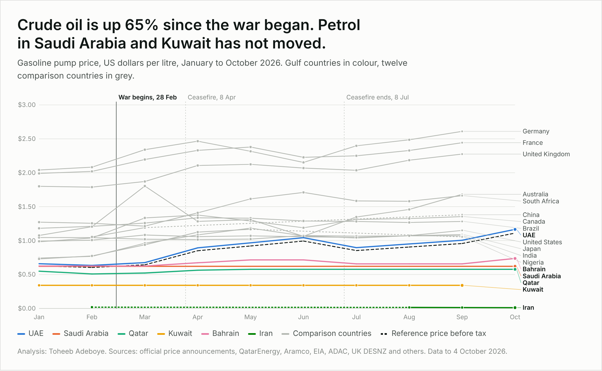

# Data Analysis Portfolio

Projects by **Toheeb Adeboye**, Data Analyst based in Doha, Qatar. [LinkedIn](https://www.linkedin.com/in/dtsquarea/)

| Project | Question | Tools | Links |
|---|---|---|---|
| [Gulf Fuel Subsidy Tracker](gulf-fuel-subsidy-tracker/) | Who is paying for cheap fuel in the Gulf since the 2026 Iran war began? | Python, SQL, JavaScript | [Dashboard](https://dtsquarea12.github.io/DATA-ANALYST-PROJECT/gulf-fuel-subsidy-tracker/) · [Write-up](gulf-fuel-subsidy-tracker/README.md) · [Notebook](gulf-fuel-subsidy-tracker/notebooks/fuel_subsidy_analysis.ipynb) |
| [Saudi Women in Work](saudi-women-workforce/) | Unemployment among Saudi women has fallen for two years. Are more of them working, or are fewer looking for work? | Python, SQL | [Write-up](saudi-women-workforce/README.md) · [Notebook](saudi-women-workforce/notebooks/saudi_women_work_analysis.ipynb) · [SQL](saudi-women-workforce/sql/analysis_queries.sql) |
| [Mobile Internet Speed by Country](mobile-internet-speed-by-country/) | Where in the world is mobile internet fastest, and how does it compare with fixed broadband in the same country? | Python, SQL | [Write-up](mobile-internet-speed-by-country/README.md) · [Notebook](mobile-internet-speed-by-country/notebooks/mobile_internet_speed_analysis.ipynb) · [SQL](mobile-internet-speed-by-country/sql/analysis_queries.sql) |
| [AI Use by Country](ai-use-by-country/) | How many working-age people use generative AI in each Middle East economy, and how does the region compare with the rest of the world? | Python, SQL | [Write-up](ai-use-by-country/README.md) · [Notebook](ai-use-by-country/notebooks/ai_use_analysis.ipynb) · [SQL](ai-use-by-country/sql/analysis_queries.sql) |
| [Corporate Tax Rates by Country](corporate-tax-rates-by-country/) | What rate of tax does a company pay on its profits in each Middle East economy, and how does the region compare with the rest of the world? | Python, SQL | [Write-up](corporate-tax-rates-by-country/README.md) · [Notebook](corporate-tax-rates-by-country/notebooks/corporate_tax_analysis.ipynb) · [SQL](corporate-tax-rates-by-country/sql/analysis_queries.sql) |
| [Passport Strength by Country](passport-strength-by-country/) | How many destinations can the holder of each Middle East passport enter without arranging a visa before travel, and how does the region compare with the rest of the world? | Python, SQL | [Write-up](passport-strength-by-country/README.md) · [Notebook](passport-strength-by-country/notebooks/passport_strength_analysis.ipynb) · [SQL](passport-strength-by-country/sql/analysis_queries.sql) |
| [Renewable Power Capacity by Country](renewable-power-capacity-by-country/) | How much renewable power capacity does each Middle East economy have, how fast did it grow in 2025, and how does the region compare with the rest of the world? | Python, SQL | [Write-up](renewable-power-capacity-by-country/README.md) · [Notebook](renewable-power-capacity-by-country/notebooks/renewable_capacity_analysis.ipynb) · [SQL](renewable-power-capacity-by-country/sql/analysis_queries.sql) |
| [Innovation Index by Country](innovation-index-by-country/) | Where does each Middle East economy rank in the Global Innovation Index 2026, which moved up since 2025, and how does the region compare with the rest of the world? | Python, SQL | [Write-up](innovation-index-by-country/README.md) · [Notebook](innovation-index-by-country/notebooks/innovation_index_analysis.ipynb) · [SQL](innovation-index-by-country/sql/analysis_queries.sql) |
| [Import Tariffs by Country](import-tariffs-by-country/) | What rate of import duty does a typical product face entering each Middle East economy, and how does the region compare with the rest of the world? | Python, SQL | [Write-up](import-tariffs-by-country/README.md) · [Notebook](import-tariffs-by-country/notebooks/import_tariffs_analysis.ipynb) · [SQL](import-tariffs-by-country/sql/analysis_queries.sql) |
| [Egypt Remittances](egypt-remittances/) | How much money do Egyptians working abroad send home each year, and how has the total changed since FY2018/19? | Python, SQL | [Write-up](egypt-remittances/README.md) · [Notebook](egypt-remittances/notebooks/egypt_remittances_analysis.ipynb) · [SQL](egypt-remittances/sql/analysis_queries.sql) |
| [Hajj Pilgrims by Year](hajj-pilgrims-by-year/) | How many pilgrims performed Hajj in 2026, and how has the split between pilgrims from abroad and from inside Saudi Arabia changed since 2008? | Python, SQL | [Write-up](hajj-pilgrims-by-year/README.md) · [Notebook](hajj-pilgrims-by-year/notebooks/hajj_pilgrims_analysis.ipynb) · [SQL](hajj-pilgrims-by-year/sql/analysis_queries.sql) |
| [Middle East Airport Passengers 2025](middle-east-airport-passengers/) | How many passengers did each major Middle East airport handle in 2025, which grew fastest, and how does the region compare with the world's busiest airports? | Python, SQL | [Write-up](middle-east-airport-passengers/README.md) · [Notebook](middle-east-airport-passengers/notebooks/airport_passengers_analysis.ipynb) · [SQL](middle-east-airport-passengers/sql/analysis_queries.sql) |
| [Saudi Real Estate Prices](saudi-real-estate-prices/) | Which kinds of property and which regions of Saudi Arabia got more or less expensive in the year to Q2 2026? | Python, SQL | [Write-up](saudi-real-estate-prices/README.md) · [Notebook](saudi-real-estate-prices/notebooks/saudi_real_estate_prices_analysis.ipynb) · [SQL](saudi-real-estate-prices/sql/analysis_queries.sql) |
| [AI Use by Saudi Businesses](saudi-business-ai-adoption/) | Which sectors of Saudi business used AI in 2025, how fast did use grow from 2024, and which sectors still trail? | Python, SQL | [Write-up](saudi-business-ai-adoption/README.md) · [Notebook](saudi-business-ai-adoption/notebooks/saudi_business_ai_adoption_analysis.ipynb) · [SQL](saudi-business-ai-adoption/sql/analysis_queries.sql) |
| [AI Use by Firm Size](ai-use-by-firm-size/) | How much less likely are small firms to use AI than large firms in Turkey and the EU, is the gap closing, and what holds firms back? | Python, SQL | [Write-up](ai-use-by-firm-size/README.md) · [Notebook](ai-use-by-firm-size/notebooks/ai_use_by_firm_size_analysis.ipynb) · [SQL](ai-use-by-firm-size/sql/analysis_queries.sql) |
| [AI Productivity at Work](ai-productivity-at-work/) | When a business gives work to AI, how much faster or better does that work get, and who gains most? | Python, SQL | [Write-up](ai-productivity-at-work/README.md) · [Notebook](ai-productivity-at-work/notebooks/ai_productivity_at_work_analysis.ipynb) · [SQL](ai-productivity-at-work/sql/analysis_queries.sql) |

