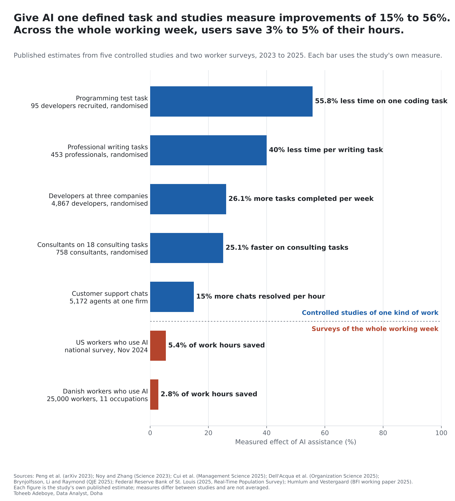
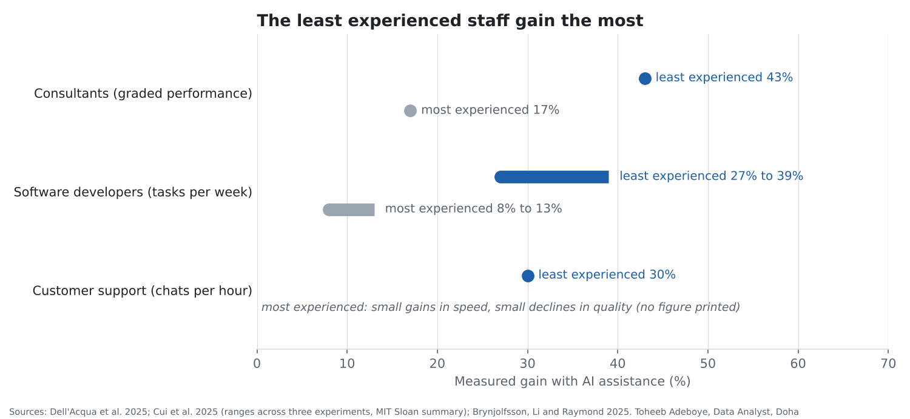

# AI Productivity at Work: What the Measured Studies Show

**When a business gives work to AI, how much faster or better does that work get, and who gains most?**

[Notebook](notebooks/ai_productivity_at_work_analysis.ipynb) · [SQL](sql/analysis_queries.sql) · [Data dictionary](docs/data_dictionary.md) · [Tidy data](data/processed/effects_tidy.csv)



## Contents

1. [Project background](#project-background)
2. [Questions](#questions)
3. [Executive summary](#executive-summary)
4. [Insights](#insights)
5. [Recommendations](#recommendations)
6. [Data](#data)
7. [Method](#method)
8. [Tools](#tools)
9. [Repository structure](#repository-structure)
10. [How to reproduce](#how-to-reproduce)
11. [Assumptions and limitations](#assumptions-and-limitations)
12. [Sources](#sources)
13. [Author](#author)

## Project background

Earlier projects in this portfolio measured how many people and businesses use AI ([AI Use by Country](../ai-use-by-country/), [AI Use by Saudi Businesses](../saudi-business-ai-adoption/), [AI Use by Firm Size](../ai-use-by-firm-size/)). Adoption says nothing about results. A business owner deciding whether to hand a workflow to AI needs a different number: how much does the work actually improve?

The best evidence comes from studies that compare workers with and without AI assistance on the same work, and from large surveys that ask workers how much time AI saves them across the whole week. This project collects the headline estimates of seven such studies, published between 2023 and 2025, from the papers themselves and from at least one other document that prints the same figure.

None of the seven studies was run in the Middle East. Searches for measured productivity results from Gulf, Levant or North African workplaces found adoption surveys and counts of AI business registrations, but no published controlled measurement of results, so this project uses the international studies. The Middle East data in this portfolio covers adoption only.

## Questions

1. When workers use AI on one defined kind of work, how much does the measured outcome improve?
2. Across the whole working week, how much time do workers who use AI say it saves?
3. Do experienced and inexperienced staff gain equally?
4. Is there work where AI made results worse?

## Executive summary

| Measure | Figure | Study |
|---|---|---|
| Time to finish one coding task | 55.8% less (71.17 vs 160.89 minutes) | Peng et al., randomised, 95 developers recruited |
| Time per professional writing task | 40% less, quality graded 18% higher | Noy and Zhang, Science 2023, 453 professionals |
| Tasks completed per week, developers at three companies | 26.08% more | Cui et al., 4,867 developers |
| Speed on 18 consulting tasks | 25.1% faster, 12.2% more tasks, quality 40% higher | Dell'Acqua et al., 758 consultants |
| Customer support chats resolved per hour | 15% more (30% for the least experienced agents) | Brynjolfsson, Li and Raymond, QJE 2025, 5,172 agents |
| Work hours saved, US workers who use AI | 5.4% (about 2.2 hours of a 40-hour week) | St. Louis Fed, November 2024 survey |
| Work hours saved, Danish workers who use AI | 2.8% | Humlum and Vestergaard, 25,000 workers |
| Consultants on a task outside what the AI did well | 19 percentage points less likely to be correct | Dell'Acqua et al. |

When AI is given one defined kind of work, five studies measure improvements of 15% to 55.8%. When workers are asked about their whole week, those who use AI report saving 2.8% to 5.4% of their hours. The gains go mostly to the least experienced staff, and on work the AI does badly, results get worse.



## Insights

**1. On one defined kind of work, measured improvements run from 15% to 55.8%.**

| Study | Work | Measure | Effect with AI |
|---|---|---|---|
| Peng et al. (2023) | Write an HTTP server in JavaScript | Time to finish | 55.8% less |
| Noy and Zhang (2023) | Occupation-specific writing tasks | Time per task | 40% less |
| Cui et al. (2025) | Developers' normal work over months | Tasks completed per week | 26.08% more |
| Dell'Acqua et al. (2025) | 18 consulting tasks | Speed | 25.1% faster |
| Brynjolfsson, Li and Raymond (2025) | Customer support chats | Chats resolved per hour | 15% more |

The measures differ (time, output, speed), so the figures are shown side by side and not averaged. The smallest effect comes from the setting closest to daily operations with real customers (customer support at one firm), and the largest from a single test task set by the researchers.

**2. Across the whole working week, the saving is about 3% to 5% of hours.**

US workers who used generative AI saved 5.4% of their work hours in the St. Louis Fed's November 2024 survey, about 2.2 hours of a 40-hour week; spread over all workers, including non-users, that is 1.4%. Danish workers in 11 occupations exposed to AI saved 2.8% on average, and the study rules out average effects on earnings or hours larger than 1%. A large improvement on one task becomes a small share of the week because the task is only part of the job.

**3. The least experienced staff gain the most.**

| Study | Least experienced | Most experienced |
|---|---|---|
| Customer support | 30% more chats per hour | small gains in speed, small declines in quality (no figure printed) |
| Consultants (graded performance) | 43% (below-average performers) | 17% (top performers) |
| Software developers (tasks per week) | 27% to 39% (recent hires and juniors) | 8% to 13% (seniors) |

In the two studies that print figures for both groups, newer or lower-scoring staff gained about two and a half to three times as much as the most experienced (43% against 17%; 27% to 39% against 8% to 13%).

**4. On work outside what the AI does well, results got worse.**

In the consulting experiment, one task was chosen because the AI of the time handled it badly. Consultants using AI on that task were 19 percentage points less likely to reach the correct answer than those working without it. The same study found the gains in insight 1 on the 18 tasks inside the AI's range.

## Recommendations

For business owners and managers deciding where to use AI:

1. **Start with one defined, repeated task.** The large measured gains come from work with clear inputs and outputs: answering customer chats, drafting documents, writing code. Pick one such workflow first rather than a general roll-out.
2. **Budget on the whole-job number, not the task number.** A 15% to 56% gain on one task translated into 2.8% to 5.4% of total hours in the surveys. Estimate the saving as the task gain times the share of the week the task takes.
3. **Measure per task, before and after.** Every study here measured one outcome per task (chats per hour, minutes per task, tasks per week). Record the same number for your own workflow before AI and after, for at least a few weeks.
4. **Expect the biggest gains from new staff.** Onboarding, first-line support and junior roles are where the studies measured the largest improvements. AI assistance can shorten the time new staff take to reach full speed.
5. **Keep a person checking work the AI is weak at.** Results got worse on a task outside the AI's range. Test the tool on your own cases before relying on it, and keep consequential decisions with a person.

## Data

| File | Rows | Content |
|---|---|---|
| `data/raw/effect_readings.csv` | 75 | Every printed reading: one row per figure per document, 21 documents |
| `data/raw/studies.csv` | 7 | Studies with authors, publication, design, setting and scope |
| `data/raw/sources.csv` | 21 | Documents with publisher, kind and link |
| `data/processed/effects_tidy.csv` | 34 | One row per figure after the agreement check |
| `data/processed/study_headlines.csv` | 7 | Main effect per study, written as a gain |
| `data/processed/gain_by_experience.csv` | 3 | Least versus most experienced staff |
| `data/processed/headline_figures.csv` | 17 | Headline figures used in this README |

Coverage: five studies that compare work with and without AI (three randomised experiments with individuals, three randomised field experiments at companies reported together, and one staggered roll-out at a single firm), plus two worker surveys (United States, Denmark). Published 2023 to 2025.

Checks done:

- No missing values, no duplicate readings.
- Every figure printed by more than one document agrees within rounding. 25 of 34 figures appear in two or more documents.
- Coding test: (160.89 - 71.17) / 160.89 = 55.76%, which rounds to the printed 55.8%.
- St. Louis Fed: 5.4% of a 40-hour week = 2.16 hours, which rounds to the printed 2.2 hours.
- One reading was set aside: the HBS AI Institute page prints the consulting quality gain as "over 40%", a lower bound rather than a value.
- The customer support study exists in two versions with different figures: the 2023 working paper (5,179 agents, 14% overall, 34% for novices) and the 2025 journal article (5,172 agents, 15% overall, about 30% for the least experienced). Both are kept in the raw data, and the published version is used in the headline.
- The notebook rebuilds the tables from the raw readings and asserts that the recomputed headline figures match the build script output.

## Method

Each figure is collected from every document that prints it. A figure printed to d decimals stands for any value within half a unit of its last digit; two readings agree when those ranges overlap. The build script stops if any two readings disagree, and keeps the most precise reading.

```
interval(x printed to d decimals) = [x - 0.5 * 10^-d, x + 0.5 * 10^-d]
readings agree  <=>  max(lower bounds) <= min(upper bounds)

time cut (%)          = 100 * (minutes_without_ai - minutes_with_ai) / minutes_without_ai
headline gain (%)     = time cut, or increase in output, speed or hours saved, as the study measures it
hours per 40h week    = 40 * time_saved_share_of_hours / 100
```

This is a structured comparison of published estimates, not a meta-analysis: the studies use different measures, so no pooled average is computed.

## Tools

Python (pandas, matplotlib), SQLite for testing the SQL, Jupyter notebook format.

## Repository structure

```
ai-productivity-at-work/
  README.md
  requirements.txt
  data/raw/effect_readings.csv            every printed reading with its source
  data/raw/studies.csv                    the seven studies
  data/raw/sources.csv                    documents and links
  data/processed/effects_tidy.csv         one row per figure, tidy, for Power BI or Tableau
  data/processed/study_headlines.csv      main effect per study
  data/processed/gain_by_experience.csv
  data/processed/headline_figures.csv
  notebooks/ai_productivity_at_work_analysis.ipynb
  scripts/build_data.py                   checks agreement and identities, builds data/processed
  scripts/make_charts.py                  draws the charts in images/
  sql/analysis_queries.sql                six queries on the tidy tables
  images/ai-productivity-at-work.png
  images/gain-by-experience.png
  docs/data_dictionary.md
```

## How to reproduce

```
pip install -r requirements.txt
python scripts/build_data.py
python scripts/make_charts.py
```

Then open the notebook. To run the SQL, load `data/processed/effects_tidy.csv` and `data/processed/study_headlines.csv` into SQLite as tables named `effects_tidy` and `study_headlines`.

## Assumptions and limitations

- **Different measures.** Time per task, tasks per week, speed, chats per hour and share of hours saved are different things. A 55.8% cut in time is not the same as a 55.8% rise in output. The figures are shown side by side with their measures and never averaged.
- **Not the Middle East.** No study here was run in the region. Results may differ with language (Arabic and English), sector mix and the tools available.
- **AI has changed since the studies ran.** The studies used the AI tools available when each was run, all before 2025. Newer tools may do better on some tasks, and the task where AI made results worse may now be inside its range.
- **Self-reported hours.** The two whole-job figures come from surveys in which workers estimate their own time saved.
- **Single-document figures.** The coding test's sample (95 recruited) and group means (71.17 and 160.89 minutes) appear only in the paper (they reproduce the 55.8% printed in two documents). The developer gains by experience (27% to 39% and 8% to 13%) appear only in the MIT Sloan summary. The 19-point drop on the task outside the AI's range appears only in the journal article; two summaries describe the same result with different figures (84% correct without AI against 60% to 70% with it; "nearly 25% worse"). The US saving across all workers (1.4%) appears in one St. Louis Fed note.
- **Several documents printing the same study confirm that a number was transcribed correctly.** They are not independent measurements of the effect.
- **Studies of willing participants.** Experiments recruited people who agreed to take part, and the firms studied chose to deploy AI. Results at a firm that is less ready may be smaller.
- The data shows measured effects in the settings studied. It does not show what any particular business will achieve.

## Sources

Customer support:

- Brynjolfsson, Li and Raymond, [Generative AI at Work](https://www.nber.org/papers/w31161), NBER Working Paper 31161 (2023), published in the Quarterly Journal of Economics 140(2), 2025
- Stanford SIEPR, [Generative AI at Work (working paper)](https://siepr.stanford.edu/publications/working-paper/generative-ai-work)
- SUFE Academic Newsletter, [QJE abstract](https://academicnewsletter.sufe.edu.cn/info/344659)
- Quantum Zeitgeist, [AI Boosts Productivity 15%, New Study Shows](https://quantumzeitgeist.com/generative-ai-at-work/)
- Silicon Canals, [AI productivity and novice workers](https://siliconcanals.com/t-ai-productivity-novice-workers-skill-compression/)

Writing:

- MIT News, [Study finds ChatGPT boosts worker productivity for some writing tasks](https://news.mit.edu/2023/study-finds-chatgpt-boosts-worker-productivity-writing-0714) (14 July 2023)
- Stanford SCALE, [Experimental evidence on the productivity effects of generative artificial intelligence](https://scale.stanford.edu/publications/experimental-evidence-productivity-effects-generative-artificial-intelligence) (Science, 2023)

Coding test:

- Peng, Kalliamvakou, Cihon and Demirer, [The Impact of AI on Developer Productivity](https://arxiv.org/pdf/2302.06590) (arXiv 2302.06590, 2023)
- DX, [Impact of AI on developer productivity](https://getdx.com/research/impact-of-ai-on-developer-productivity-evidence-from-copilot/)

Consulting:

- Dell'Acqua, McFowland, Mollick and others, [Navigating the Jagged Technological Frontier](https://pubsonline.informs.org/doi/full/10.1287/orsc.2025.21838), Organization Science (2025)
- Ethan Mollick, [Centaurs and Cyborgs on the Jagged Frontier](https://www.oneusefulthing.org/p/centaurs-and-cyborgs-on-the-jagged)
- The Decoder, [GPT-4 could be the great skill leveler for consultants](https://the-decoder.com/gpt-4-could-be-the-great-skill-leveler-for-consultants/)
- The 80/20 newsletter, [Consulting and generative AI](https://the8020newsletter.substack.com/p/consulting-generative-ai)
- HBS AI Institute, [Navigating the Jagged Technological Frontier](https://aiinstitute.hbs.edu/navigating-the-jagged-technological-frontier/)

Developers at three companies:

- Cui, Demirer, Jaffe, Musolff, Peng and Salz, [The Effects of Generative AI on High-Skilled Work](https://www.microsoft.com/en-us/research/?p=1148213) (Management Science, 2025)
- CO/AI, [AI boosts developer productivity by 26% in landmark study](https://getcoai.com/news/ai-boosts-developer-productivity-by-26-in-landmark-study)
- MIT Sloan, [How generative AI affects highly skilled workers](https://mitsloan.mit.edu/ideas-made-to-matter/how-generative-ai-affects-highly-skilled-workers)

Whole-job surveys:

- Federal Reserve Bank of St. Louis, [The Impact of Generative AI on Work Productivity](https://www.stlouisfed.org/on-the-economy/2025/feb/impact-generative-ai-work-productivity) (February 2025)
- Federal Reserve Bank of St. Louis, [Generative AI, Productivity and the Future of Work](https://www.stlouisfed.org/open-vault/2025/oct/generative-ai-productivity-future-work) (October 2025)
- Humlum and Vestergaard, Large Language Models, Small Labor Market Effects (Becker Friedman Institute working paper, 2025), as quoted by [Marginal Revolution](https://marginalrevolution.com/marginalrevolution/2025/04/large-language-models-small-labor-market-effects.html) and [Techstrong.ai](https://techstrong.ai/agentic-ai/ai-hasnt-impacted-jobs-or-wages-yet-study/)

## Author

Toheeb Adeboye, Data Analyst, Doha, Qatar. Founder of Baynor AI (https://baynor.qa). [LinkedIn](https://www.linkedin.com/in/dtsquarea/)
