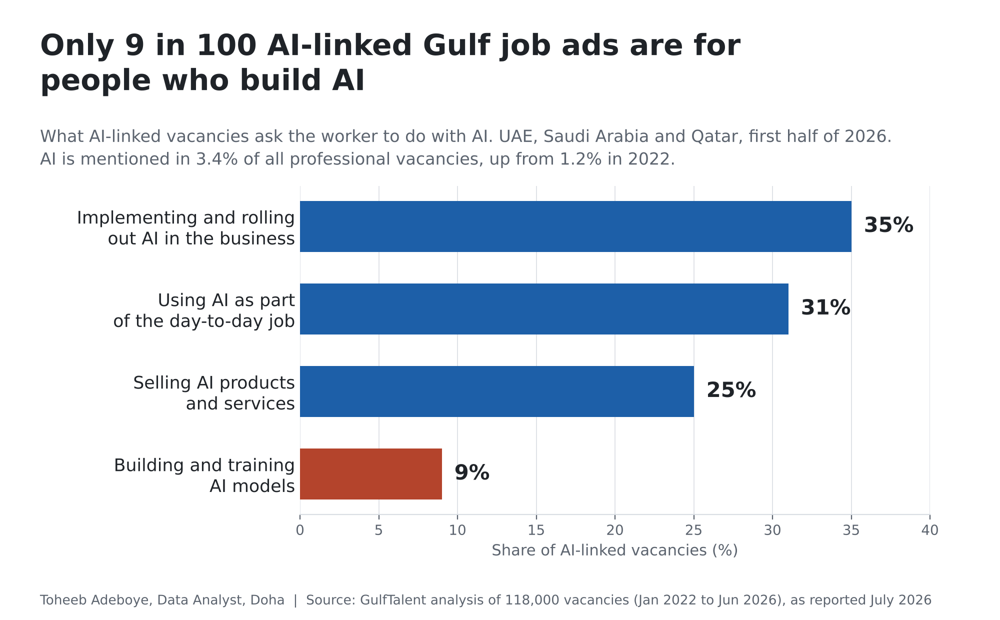
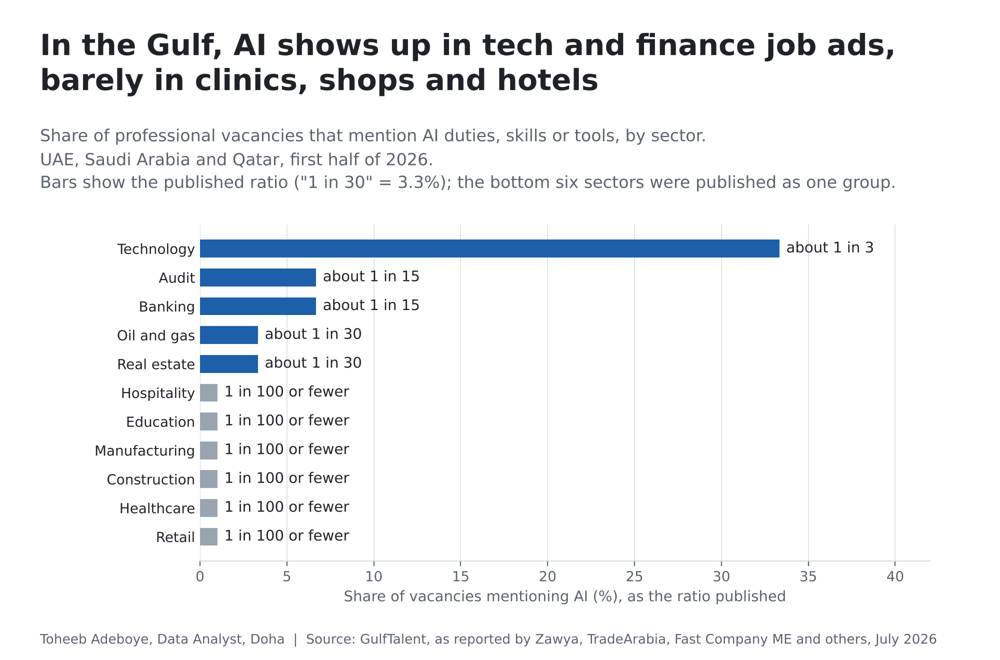
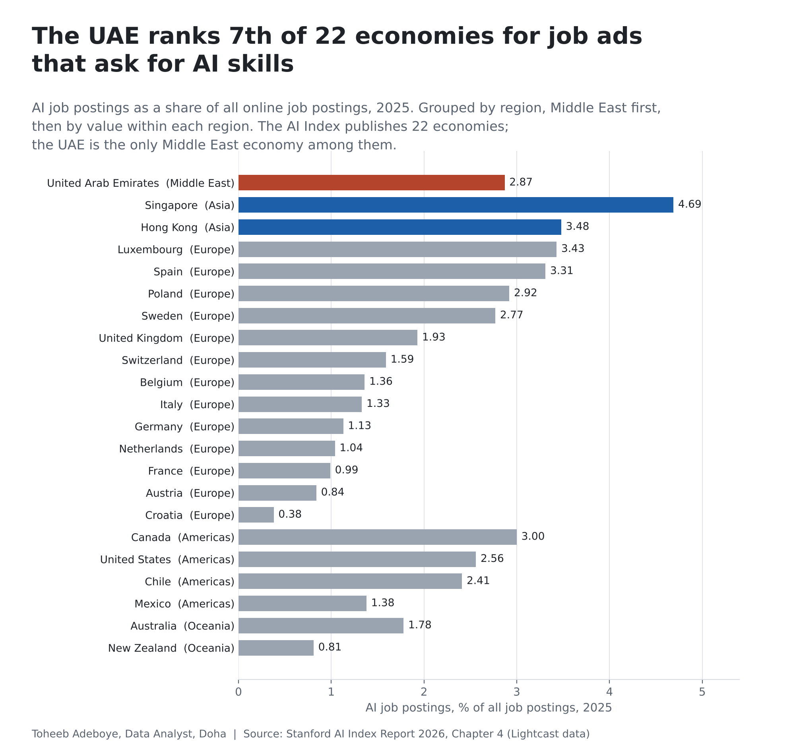

# AI Skills in Job Ads: What Gulf Employers Are Hiring For

**How often do Gulf job ads ask for AI, in which sectors, for what kind of AI work, and how does the region compare with the rest of the world?**

[Notebook](notebooks/ai_skills_in_job_ads_analysis.ipynb) · [SQL](sql/analysis_queries.sql) · [Data dictionary](docs/data_dictionary.md) · [Tidy data](data/processed/readings_tidy.csv)



## Contents

1. [Project background](#project-background)
2. [Questions](#questions)
3. [Executive summary](#executive-summary)
4. [Insights](#insights)
5. [Recommendations](#recommendations)
6. [Data](#data)
7. [Method](#method)
8. [Tools](#tools)
9. [Repository structure](#repository-structure)
10. [How to reproduce](#how-to-reproduce)
11. [Assumptions and limitations](#assumptions-and-limitations)
12. [Sources](#sources)
13. [Author](#author)

## Project background

Earlier projects in this portfolio measured how many people and firms use AI ([AI Use by Country](../ai-use-by-country/), [AI Use by Saudi Businesses](../saudi-business-ai-adoption/), [AI Use by Firm Size](../ai-use-by-firm-size/)) and what AI does to the work itself ([AI Productivity at Work](../ai-productivity-at-work/)). This project looks at the hiring side: when employers write a job ad, how often do they ask for AI, and what do they want the person to do with it?

Job ads are a useful signal for a business owner. They show which sectors are already building AI into their teams, which are not yet, and whether the demand is for engineers who build AI or for staff who use and roll it out.

Three published sources measure this:

- **GulfTalent**, a Gulf recruitment platform, analysed 118,000 direct employer vacancies posted in the UAE, Saudi Arabia and Qatar between January 2022 and June 2026, and classified 420 AI-linked vacancies from H1 2026 by role type. The findings were published in July 2026 and reported by at least ten outlets.
- **PwC's 2026 AI Jobs Barometer** (Lightcast job-ad data, more than one billion ads in 27 countries) publishes a UAE analysis.
- **The Stanford AI Index Report 2026** (Lightcast data) prints the AI share of job postings for 22 economies in 2025 and for 15 US sectors in 2024 and 2025.

The three use different job-ad pools and definitions, so they are shown side by side and never mixed in one ranking.

## Questions

1. What share of Gulf job vacancies mention AI, and how has that changed since 2022?
2. Which sectors ask for AI most and least?
3. Do AI-linked vacancies ask people to build AI, or to use, roll out and sell it?
4. How does the Middle East compare with other regions?

## Executive summary

| Figure | Value | Source |
|---|---|---|
| Gulf professional vacancies mentioning AI, 2022 | 1.2% | GulfTalent |
| Gulf professional vacancies mentioning AI, H1 2026 | 3.4% (about 1 in 30), 2.8 times 2022 | GulfTalent |
| AI-linked Gulf vacancies that build or train AI models | 9% | GulfTalent |
| AI-linked Gulf vacancies that implement or use AI | 66% (35% + 31%) | GulfTalent |
| UAE postings needing AI skills, 2021 to 2025 | 1.0% to 3.2%; 4,600 to 12,200 postings | PwC / Lightcast |
| UAE AI job postings share, 2025 | 2.87%, 7th of 22 economies (median 1.86%) | AI Index 2026 / Lightcast |

The share of Gulf job ads that mention AI has nearly tripled since 2022 but is still about 1 in 30. Most of that demand sits in technology, banking and audit. In healthcare, retail, hospitality, construction, manufacturing and education, 1 in 100 vacancies or fewer mention AI. When a Gulf job ad does mention AI, it is far more likely to ask the person to roll AI out, use it in the job or sell it than to build it.



## Insights

### 1. AI is now in about 1 in 30 Gulf job ads, nearly three times the 2022 share

GulfTalent's share of professional vacancies that mention AI duties, skills or tools rose from 1.2% in 2022 to 3.4% in the first half of 2026, a multiple of 2.83. PwC's Lightcast-based series for the UAE shows the same direction: 1.0% of postings needed AI skills in 2021 and 3.2% in 2025, when the number of such postings reached about 12,200 (from 4,600 in 2021). In 2025 the UAE share equalled PwC's 27-country average of 3.2%.

| Series | First | Last |
|---|---|---|
| GulfTalent, UAE + Saudi Arabia + Qatar | 1.2% (2022) | 3.4% (H1 2026) |
| PwC / Lightcast, UAE | 1.0% (2021) | 3.2% (2025) |
| PwC / Lightcast, 27-country average | 1.8% (2021) | 3.2% (2025) |
| PwC / Lightcast, India | 4.4% (2021) | 8.1% (2025) |
| PwC / Lightcast, China (Mainland) | 5.2% (2021) | 6.4% (2025) |

### 2. Tech, banking and audit lead; six large sectors are at 1 in 100 or fewer

| Sector (Gulf, H1 2026) | Published ratio | Exact share, one outlet |
|---|---|---|
| Technology | about 1 in 3 | 31.6% |
| Banking | about 1 in 15 | 8.1% |
| Audit | about 1 in 15 | 5.8% |
| Oil and gas | about 1 in 30 | 3.6% |
| Real estate | about 1 in 30 | 2.6% |
| Construction, retail, healthcare, manufacturing, education, hospitality | 1 in 100 or fewer | 1% or less (group) |

Senior leadership vacancies mention AI about twice as often as individual contributor roles (about 1 in 12 against about 1 in 30).

### 3. Two in three AI-linked jobs are about using or rolling out AI, fewer than one in ten about building it

Of 420 AI-linked Gulf vacancies classified for H1 2026, 35% are about implementing and rolling out AI, 31% about using AI as part of the job, 25% about selling AI products and services, and 9% about building and training AI models. See the chart at the top.

### 4. Middle East first, then the rest of the world: the UAE sits 7th of 22

The AI Index 2026 prints 2025 AI job-posting shares for 22 economies. The UAE is the only Middle East economy in the table.

| Region | Economies | Mean share | Range |
|---|---|---|---|
| Middle East (UAE) | 1 | 2.87% | 2.87% |
| Asia | 2 | 4.08% | 3.48% (Hong Kong) to 4.69% (Singapore) |
| Americas | 4 | 2.34% | 1.38% (Mexico) to 3.00% (Canada) |
| Europe | 13 | 1.77% | 0.38% (Croatia) to 3.43% (Luxembourg) |
| Oceania | 2 | 1.29% | 0.81% (New Zealand) to 1.78% (Australia) |

The UAE (2.87%) is above the United States (2.56%), the United Kingdom (1.93%), Germany (1.13%) and France (0.99%), and below Singapore, Hong Kong, Luxembourg, Spain, Canada and Poland.



### 5. In the US, every sector's AI share rose in 2025

The AI Index prints US shares for 15 sectors. All 15 rose from 2024 to 2025. The information sector went from 7.82% to 13.22%, finance and insurance from 3.27% to 5.33%, real estate from 1.08% to 2.08% and retail from 1.04% to 1.67%. The US and Gulf figures come from different job-ad pools and sector definitions, so they show the same pattern (tech and finance first) rather than a like-for-like gap.

## Recommendations

For business owners and managers in the Gulf:

1. **Train before you hire.** Two thirds of AI-linked vacancies ask for people who use or roll out AI, and fewer than one in ten for people who build it. Most businesses can start by giving existing staff time and training to use AI on one workflow, rather than recruiting an AI engineer.
2. **Treat a low sector share as an opening.** In healthcare, retail, hospitality, construction, manufacturing and education, 1 in 100 vacancies or fewer mention AI. A clinic, shop or hotel that puts AI into one process now is ahead of most of its hiring market.
3. **Write AI into the job ad when the job uses it.** If a role will use AI tools, say so. Candidates in tech, banking and audit already expect it, and it filters for people who can work that way.
4. **Give a senior person ownership.** Leadership vacancies mention AI about twice as often as other roles, which suggests firms put AI responsibility at management level. Name one manager who owns the first AI workflow and its results.
5. **Budget for implementation, not only tools.** The largest single group of AI-linked roles (35%) is about rolling AI out. Plan time and money for setting up, testing and changing the process, not only for the software.

## Data

| File | Rows | Content |
|---|---|---|
| `data/raw/readings.csv` | 291 | Every figure as printed, one row per figure per document |
| `data/raw/sources.csv` | 16 | Documents read |
| `data/processed/readings_tidy.csv` | 104 | Figures after reconciling documents, with verification status |
| `data/processed/ai_share_trend.csv` | 10 | Share of job ads mentioning AI over time (Gulf, UAE, 27-country average, India, China) |
| `data/processed/gulf_ai_share_by_sector.csv` | 11 | Gulf share by sector, H1 2026 |
| `data/processed/gulf_ai_vacancies_by_role.csv` | 4 | AI-linked Gulf vacancies by role type |
| `data/processed/ai_share_by_country_2025.csv` | 22 | AI job postings share by economy, 2025 |
| `data/processed/us_ai_share_by_sector.csv` | 15 | US AI job postings share by sector, 2024 and 2025 |
| `data/processed/headline_figures.csv` | 12 | Figures used in this README |

Coverage: UAE, Saudi Arabia and Qatar combined (GulfTalent); the UAE, India, China and a 27-country average (PwC); 22 economies in five regions and 15 US sectors (AI Index).

Checks run by `scripts/build_data.py` (the build fails if any check fails):

- Every figure printed by two or more documents is compared using rounding intervals; no two documents disagree.
- 3.4% matches the printed "about 1 in 30"; 3.4 / 1.2 matches "nearly tripled".
- The four role shares add to exactly 100, and each sits within 3 points of the "a third / a third / a quarter" wording printed by eight other outlets; 9% sits below "fewer than one in ten".
- The exact sector shares printed by one outlet sit within a quarter of the ratios printed by eight or nine others.
- PwC's UAE postings rise by 12.2 - 9.5 = 2.7 thousand, matching the printed "around 2,700"; 3.2 - 1.0 matches the printed +2.2 points.
- The AI Index country table has 22 rows and was read three times from the PDF with identical values; the US sector table has 15 rows, read twice, and all 15 rise.

37 of 104 figures are printed in two or more documents. Figures set aside: the Lightcast highlight's US figure of 2.5% (its own country section prints 2.6%, matching 2.56), and US 2.5%, UK 1.9% and Singapore 4.8% quoted without a year in the GulfTalent coverage.

## Method

Share of job ads mentioning AI, as each publisher defines it:

```
AI share (%) = vacancies or postings that mention AI skills, duties or tools
               / all vacancies or postings in the same pool x 100

Ratio printed as "1 in N"  ->  100 / N  (1 in 30 = 3.33%)
Multiple 2022 to H1 2026   =  3.4 / 1.2 = 2.83
```

No figure was estimated or interpolated. Where a sector was published only as a ratio, the chart uses the ratio and the table shows the exact value printed by one outlet next to it. The six lowest sectors were published as one group and are shown with the group's upper bound.

The result depends on the data source: for the UAE in 2025, PwC's Lightcast analysis gives 3.2% and the AI Index's Lightcast table gives 2.87%. Both are reported; they use different definitions of an AI skill and are not combined.

## Tools

Python (pandas, matplotlib), SQL (SQLite), Jupyter notebook format.

## Repository structure

```
ai-skills-in-job-ads/
  README.md
  requirements.txt
  data/raw/readings.csv              every figure as printed, with source
  data/raw/sources.csv               documents read
  data/processed/                    tidy tables for analysis, Power BI or Tableau
  notebooks/ai_skills_in_job_ads_analysis.ipynb
  scripts/build_data.py              rebuilds data/processed and runs the checks
  scripts/make_charts.py             draws the charts in images/
  sql/analysis_queries.sql           queries on the tidy tables
  images/                            charts
  docs/data_dictionary.md            every column of every file
```

## How to reproduce

```
pip install -r requirements.txt
python scripts/build_data.py
python scripts/make_charts.py
```

Open the notebook to recompute the headline figures; its last cell asserts they match `data/processed/headline_figures.csv`. To run the SQL, load each processed CSV into SQLite as a table named after the file.

## Assumptions and limitations

- **GulfTalent is one platform's vacancies.** The 118,000 vacancies are those posted directly by employers on GulfTalent, which leans towards professional and white-collar roles. They are not a census of all Gulf jobs, and Saudi Arabia, the UAE and Qatar are not shown separately.
- **Sector shares are mostly ratios.** Nine outlets print the sector results as "about 1 in N". Exact percentages appear in one outlet only. Banking and audit were printed together as "about 1 in 15".
- **The role split rests on 420 vacancies** from one half-year, printed exactly by two outlets and as fractions by eight.
- **Different pools, different numbers.** GulfTalent, PwC and the AI Index each define and count AI job ads differently, so their figures are shown side by side, not ranked together. Several news outlets repeating the same GulfTalent release confirm that the numbers were transcribed correctly; they are not independent measurements.
- **Most AI Index country values rest on one document.** 8 of 22 are confirmed in a second document (UAE in Gulf News and Gulf Business; seven others rounded in Lightcast's own summary). No 2024 country values are printed in the 2026 edition, so country change over time is not shown.
- **A mention is not a hire.** Job ads show intent to recruit, not filled roles or AI use inside the firm.
- The GulfTalent report page itself could not be opened when the data was collected (July coverage used instead).

## Sources

GulfTalent vacancy analysis (July 2026), as reported by:

- Middle East AI News, [AI now features in 1 in 30 new Gulf jobs](https://www.middleeastainews.com/p/ai-now-features-in-1-in-30-new-gulf)
- Zawya, [AI hiring gains pace in Gulf, though most industries lag](https://www.zawya.com/en/business/technology-and-telecom/ai-hiring-gains-pace-in-gulf-though-most-industries-lag-dp59l7up)
- Fast Company Middle East, [AI-related job vacancies in the Gulf nearly triple in four years](https://fastcompanyme.com/news/ai-related-job-vacancies-in-the-gulf-nearly-triple-in-four-years/)
- MIT Sloan Management Review Middle East, [AI skills now feature in 1 in 30 Gulf job vacancies](https://www.mitsloanme.com/article/ai-skills-now-feature-in-1-in-30-gulf-job-vacancies-up-nearly-3x-since-2022-report/)
- TradeArabia, [AI hiring gains pace in Gulf, though most industries lag](https://www.tradearabia.com/News/465235/AI-hiring-gains-pace-in-Gulf-though-most-industries-lag)
- Gulf Daily News, [AI hiring gains pace in Gulf](https://www.gdnonline.com/Details/1400841)
- Further Arabia, [Gulf AI jobs surge to 3.4% of vacancies in 2026](https://furtherarabia.com/gulf-ai-jobs-surge-to-3-4-of-vacancies-in-2026/)
- Tech Magazine, [Gulf AI job vacancies nearly triple, but hiring stays lopsided](https://techmgzn.com/gulf-ai-job-vacancies-nearly-triple-but-hiring-stays-lopsided/)
- ArabAd, [Gulf AI hiring triples in four years](https://www.arabaddigital.com/en/article/6210-gulf-ai-hiring-triples-in-four-years-as-demand-expands-beyond-technical-roles)
- Acquism, [One in every 30 jobs: inside the Gulf's AI hiring boom](https://acquism.com/articles/inside-the-gulfs-ai-hiring-boom/)

PwC 2026 AI Jobs Barometer:

- PwC Middle East, [AI Jobs Barometer UAE 2026](https://www.pwc.com/m1/en/publications/ai-jobs-barometer-uae-2026.html)
- PwC, [2026 AI Jobs Barometer: UAE analysis (PDF)](https://www.pwc.com/gx/en/issues/artificial-intelligence/job-barometer/aijb-2026-uae.pdf)

Stanford AI Index 2026:

- Stanford HAI, [AI Index Report 2026, Chapter 4: Economy (PDF)](https://hai.stanford.edu/assets/files/ai_index_report_2026_chapter_4_economy.pdf), Figures 4.4.1, 4.4.2 and 4.4.9
- Lightcast, [Stanford AI Index 2026](https://lightcast.io/resources/research/stanford-ai-index-2026)
- Gulf News, [UAE ranks among leading global AI hubs in AI Index 2026](https://gulfnews.com/business/economy/uae-ranks-among-leading-global-ai-hubs-in-ai-index-2026-1.500508377)
- Gulf Business, [UAE among top hubs in global AI Index 2026](https://gulfbusiness.com/en/2026/artificial-intelligence/uae-among-top-hubs-in-global-ai-index-2026/)

## Author

Toheeb Adeboye, Data Analyst, Doha, Qatar. Founder of Baynor AI (https://baynor.qa). [LinkedIn](https://www.linkedin.com/in/dtsquarea/)
