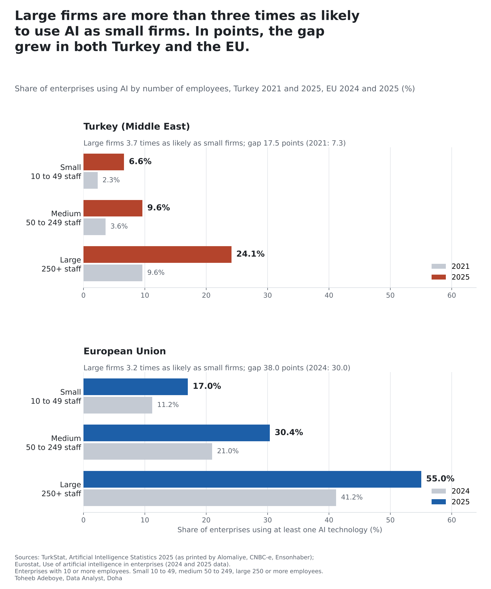
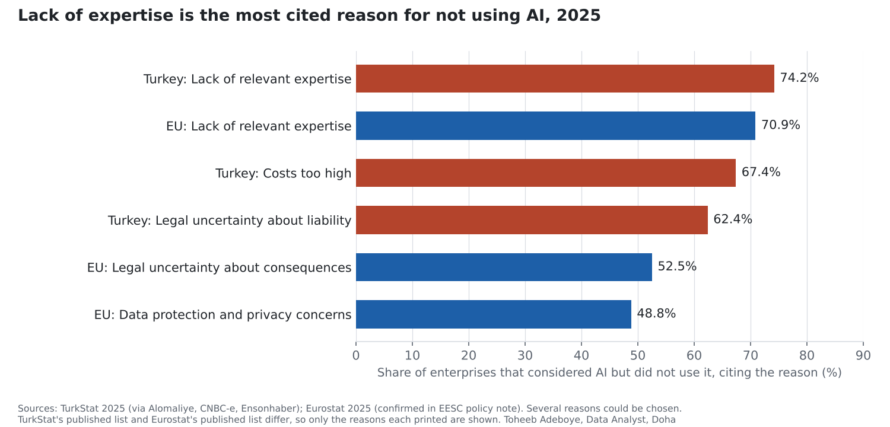

# AI Use by Firm Size: Turkey and the EU

**How much less likely are small firms to use AI than large firms, is the gap closing, and what holds firms back?**

[Notebook](notebooks/ai_use_by_firm_size_analysis.ipynb) · [SQL](sql/analysis_queries.sql) · [Data dictionary](docs/data_dictionary.md) · [Tidy data](data/processed/ai_use_tidy.csv)



## Contents

1. [Project background](#project-background)
2. [Questions](#questions)
3. [Executive summary](#executive-summary)
4. [Insights](#insights)
5. [Recommendations](#recommendations)
6. [Data](#data)
7. [Method](#method)
8. [Tools](#tools)
9. [Repository structure](#repository-structure)
10. [How to reproduce](#how-to-reproduce)
11. [Assumptions and limitations](#assumptions-and-limitations)
12. [Sources](#sources)
13. [Author](#author)

## Project background

The Turkish Statistical Institute (TurkStat) and Eurostat run the same survey of ICT use in enterprises. Both count enterprises with 10 or more employees, both split them into small (10 to 49 employees), medium (50 to 249) and large (250 or more) firms, and both ask whether the enterprise used at least one AI technology, what it used AI for, and, for firms that did not, whether they had considered it and why they held back.

Because the questionnaire and the size classes are shared, the two sets of results can be read side by side. Most AI adoption figures are national totals. The split by firm size answers a question a smaller business owner can act on: how far behind larger firms are businesses of my size, and is the reason cost, rules or know-how?

Turkey is shown first as the Middle East economy covered by this survey. No Gulf statistics office publishes AI use by firm size on the same basis (GASTAT's survey of Saudi establishments uses a different base and includes micro firms, see [AI Use by Saudi Businesses](../saudi-business-ai-adoption/)).

## Questions

1. What share of small, medium and large enterprises used AI in 2025, in Turkey and in the EU?
2. How wide is the gap between large and small firms, and did it narrow or widen?
3. Among firms not using AI, how many had considered it, and why did they hold back?
4. What do firms that use AI use it for?

## Executive summary

| Measure | Turkey (Middle East) | EU-27 |
|---|---|---|
| Small firms (10 to 49 employees) using AI, 2025 | 6.6% | 17.0% |
| Medium firms (50 to 249), 2025 | 9.6% | 30.36% |
| Large firms (250+), 2025 | 24.1% | 55.03% |
| All firms with 10+ employees, 2025 | 7.5% | 19.95% |
| Large firms as a multiple of small, 2025 | 3.7 times | 3.2 times |
| Gap large minus small, earlier year | 7.3 pts (2021) | 29.96 pts (2024) |
| Gap large minus small, 2025 | 17.5 pts | 38.03 pts |
| Most cited reason for not using AI, among firms that considered it | Lack of relevant expertise, 74.2% | Lack of relevant expertise, 70.89% |
| Most common use among AI users | Marketing or sales, 46.5% | Marketing or sales, 34.70% |

In both Turkey and the EU, a large firm is more than three times as likely to use AI as a small one. Small firms grew fastest in percent (EU +51.7% in a year, Turkey nearly tripled since 2021), so the ratio narrowed. But large firms added more in points, so the gap in points widened: in the EU from 30.0 to 38.0 points in one year, in Turkey from 7.3 to 17.5 points since 2021. Among firms that had considered AI and did not use it, seven in ten in both places named lack of expertise as a reason, ahead of legal uncertainty and, in Turkey, cost.



## Insights

**1. A large firm is more than three times as likely to use AI as a small one, in Turkey and in the EU.**

| 2025 | Small | Medium | Large | Large / small |
|---|---|---|---|---|
| Turkey | 6.6% | 9.6% | 24.1% | 3.7 |
| EU-27 | 17.0% | 30.36% | 55.03% | 3.2 |

The levels differ widely: EU small firms (17.0%) use AI at almost three times the rate of Turkish small firms (6.6%). The shape is the same: use rises with size, and the step from medium to large is the steepest.

**2. Small firms grew fastest in percent, large firms added the most points.**

| Economy | Size | From | To (2025) | Change (pts) | Change (%) |
|---|---|---|---|---|---|
| Turkey | Small | 2.3% (2021) | 6.6% | +4.3 | +187.0% |
| Turkey | Medium | 3.6% (2021) | 9.6% | +6.0 | +166.7% |
| Turkey | Large | 9.6% (2021) | 24.1% | +14.5 | +151.0% |
| EU-27 | Small | 11.21% (2024) | 17.0% | +5.79 | +51.7% |
| EU-27 | Medium | 20.97% (2024) | 30.36% | +9.39 | +44.8% |
| EU-27 | Large | 41.17% (2024) | 55.03% | +13.86 | +33.7% |

The ratio of large to small fell (EU 3.67 to 3.24; Turkey 4.17 to 3.65). The difference in points rose (EU 29.96 to 38.03; Turkey 7.3 to 17.5). Which one counts as "closing the gap" depends on the measure; both are shown here.

**3. Most small firms that do not use AI have not considered it.**

| Share of non-users that considered AI, 2025 | Small | Medium | Large | All |
|---|---|---|---|---|
| Turkey | 8.4% | 10.4% | 18.2% | 9.0% |
| EU-27 | 12.65% | 22.26% | 36.54% | 14.21% |

Among small firms not using AI, 8.4% in Turkey and 12.65% in the EU had considered it. The EU figures appear in one Eurostat document only.

**4. Firms that looked at AI and stopped most often lacked the expertise.**

| Reason, among firms that considered AI but did not use it, 2025 | Turkey | EU-27 |
|---|---|---|
| Lack of relevant expertise | 74.2% | 70.89% |
| Costs too high | 67.4% | not in the published text |
| Legal uncertainty (Turkey: liability for harm caused by AI; EU: legal consequences) | 62.4% | 52.52% |
| Data protection and privacy concerns | not in the published text | 48.83% |

Firms could give several reasons. The published releases print different subsets of the reason list, so only the reasons each printed are shown.

**5. Marketing and sales is the most common use of AI in both.**

Among Turkish firms using AI: marketing or sales 46.5%, production or service processes 41.1%, R&D or innovation 41.0%, business administration and management 40.0%, accounting, control or financial management 33.7%, ICT security 22.6%, logistics 13.6%. Among EU firms using AI: marketing or sales 34.70%, business administration and management 31.05%, logistics 6.08% (Eurostat document only).

## Recommendations

For owners and managers of firms with fewer than 50 employees:

1. **Treat know-how, not price, as the first thing to solve.** Lack of expertise is the most cited reason in both surveys, ahead of cost. A small firm can start with one narrow task and one person responsible for it, rather than a broad AI plan.
2. **Start where AI users already start.** Marketing and sales is the most common use in both Turkey and the EU, and business administration follows. These are tasks with clear inputs and outputs (enquiries, follow-ups, documents), which makes results easy to check.
3. **Settle the legal question early.** Legal uncertainty is cited by 62.4% of Turkish and 52.52% of EU firms that held back. Decide in advance which decisions stay with a person and what data the tool may see.
4. **Measure your own use against your size class, not the national total.** A small firm compared with the national rate looks further behind than it is: in the EU, 17.0% of small firms against 19.95% of all firms; in Turkey, 6.6% against 7.5%.

For trade associations and training providers: the gap in points is widening, and expertise is the main barrier, so short practical training for small firms is where the data points.

## Data

| File | Rows | Content |
|---|---|---|
| `data/raw/ai_use_readings.csv` | 110 | Every printed reading: one row per figure per document, 13 documents |
| `data/raw/sources.csv` | 13 | Documents with publisher, kind and link |
| `data/processed/ai_use_tidy.csv` | 41 | One row per figure after the agreement check |
| `data/processed/ai_use_by_size.csv` | 4 | Turkey 2021 and 2025, EU 2024 and 2025, with gap and ratio |
| `data/processed/headline_figures.csv` | 16 | Headline figures used in this README |

Coverage: Turkey (TurkStat, 2021 and 2025, enterprises with 10+ employees) and the EU-27 (Eurostat, 2023 total, 2024 and 2025 by size class).

Checks done:

- No missing values, no duplicate readings, all values between 2.3% and 74.2%.
- Every figure printed by more than one document agrees within rounding (see Method). 34 of 41 figures appear in two or more documents.
- Eurostat prints the EU rise from 2024 to 2025 as 6.47 points; 19.95 minus 13.48 gives 6.47.
- Five readings were set aside: two values in the trade.gov.pl article that are cut short rather than rounded (20.97 printed as 20.9, 41.17 as 41.1), and three reasons in the BCCI article (70.31%, 53.61%, 52.72%) that differ from the Eurostat text and the EESC policy note (70.89%, 52.52%, 48.83%).
- The notebook rebuilds the tables from the raw readings and asserts that all 16 headline figures match the build script output.

## Method

Each figure is collected from every document that prints it. A figure printed to d decimals stands for any value within half a unit of its last digit; two readings agree when those ranges overlap. The build script stops if any two readings disagree, and keeps the most precise reading.

```
interval(x printed to d decimals) = [x - 0.5 * 10^-d, x + 0.5 * 10^-d]
readings agree  <=>  max(lower bounds) <= min(upper bounds)

gap (points)  = large_pct - small_pct
ratio         = large_pct / small_pct
change (pts)  = pct_2025 - pct_earlier
change (%)    = 100 * (pct_2025 - pct_earlier) / pct_earlier
```

## Tools

Python (pandas, matplotlib), SQLite for testing the SQL, Jupyter notebook format.

## Repository structure

```
ai-use-by-firm-size/
  README.md
  requirements.txt
  data/raw/ai_use_readings.csv        every printed reading with its source
  data/raw/sources.csv                documents and links
  data/processed/ai_use_tidy.csv      one row per figure, tidy, for Power BI or Tableau
  data/processed/ai_use_by_size.csv   size classes side by side with gap and ratio
  data/processed/headline_figures.csv
  notebooks/ai_use_by_firm_size_analysis.ipynb
  scripts/build_data.py               checks agreement and builds data/processed
  scripts/make_charts.py              draws the charts in images/
  sql/analysis_queries.sql            seven queries on the tidy table
  images/ai-use-by-firm-size.png
  images/reasons-not-using-ai.png
  docs/data_dictionary.md
```

## How to reproduce

```
pip install -r requirements.txt
python scripts/build_data.py
python scripts/make_charts.py
```

Then open the notebook. To run the SQL, load `data/processed/ai_use_tidy.csv` into SQLite as a table named `ai_use_tidy`.

## Assumptions and limitations

- **What is measured.** Use of at least one AI technology from a list in the questionnaire, during the survey year. It says whether a firm uses AI at all, not how much, for how many tasks or with what result.
- **The list of AI technologies grew in 2025.** The 2025 EU results include AI that generates pictures, video or sound (used by 9.55% of EU enterprises), which the seven technologies reported for 2024 did not include. Part of the rise from 2024 (EU) or 2021 (Turkey) to 2025 may come from the longer list. Comparisons between size classes in the same year are not affected.
- **Turkey 2021 to 2025 spans four years**, the EU comparison one year. The two changes are not on the same footing and are not compared with each other.
- **Turkish figures come from news reprints of the TurkStat bulletin** (Alomaliye, CNBC-e, Ensonhaber, AGBI). The TurkStat site was not read directly. Several outlets printing the same release confirm that a number was transcribed correctly; they are not independent measurements.
- **Single-document figures.** The EU share of non-users that considered AI (all four size classes) and the EU purposes (marketing or sales 34.70%, business administration 31.05%, logistics 6.08%) appear only in the Eurostat article.
- **Reasons are not fully comparable.** The Turkish and EU releases print different parts of the reason list, and the legal reason is worded differently (liability for harm in Turkey, legal consequences in the EU). Reasons are asked only of firms that considered AI and did not use it, which is a small group among small firms.
- **Size class only.** The size gap also reflects differences in sector mix between small and large firms. The published tables do not allow both at once.
- The data shows how many firms use AI, not why. The analysis does not attribute changes to any cause.

## Sources

Official:

- Eurostat, [Use of artificial intelligence in enterprises](https://ec.europa.eu/eurostat/statistics-explained/index.php?title=Use_of_artificial_intelligence_in_enterprises) (Statistics Explained, data extracted December 2025)
- Eurostat news, [Usage of AI technologies increasing in EU enterprises](https://ec.europa.eu/eurostat/web/products-eurostat-news/w/ddn-20250123-3) (23 January 2025)
- European Economic and Social Committee, [AI policy note](https://www.eesc.europa.eu/sites/default/files/2026-03/ai_policy_note_final.pdf) (March 2026)

TurkStat, Artificial Intelligence Statistics 2025, as printed by:

- Alomaliye, [Yapay Zeka Istatistikleri, 2025](https://www.alomaliye.com/2025/10/01/yapay-zeka-istatistikleri-2025/)
- CNBC-e, [TUIK'ten ilk kez yapay zeka istatistikleri](https://www.cnbce.com/teknoloji/tuikten-ilk-kez-yapay-zeka-kullanimina-iliskin-istatistik-turkiyede-kac-kisi-uretken-yapay-zeka-kullaniyor-en-cok-hangi-sektor-kullaniyor-h17836)
- Ensonhaber, [TUIK'in yapay zeka karnesi 2025](https://www.ensonhaber.com/tuikin-yapay-zeka-karnesi-2025-iste-turkiye-sonuclari-h1477328)
- AGBI, [Turkish business use of AI lags public uptake](https://www.agbi.com/ai/2025/12/turkish-business-use-of-ai-lags-public-uptake/)

Eurostat figures as reported by:

- Namirial Focus, [Artificial intelligence: companies and EU countries leading adoption](https://focus.namirial.com/en/artificial-intelligence-companies-and-eu-countries-leading-adoption/)
- Bulgarian Chamber of Commerce and Industry, [Why companies that considered AI decided against it](https://ai.bcci.bg/en/news/why-companies-that-considered-ai-decided-against-it)
- Polish Investment and Trade Agency, [Artificial intelligence in the European Union: leaders and outsiders](https://www.trade.gov.pl/en/news/artificial-intelligence-in-the-european-union-leaders-and-outsiders)
- Cloud News, [The use of artificial intelligence in EU companies grows in 2024](https://cloudnews.tech/the-use-of-artificial-intelligence-in-eu-companies-grows-in-2024/)
- Kosice IT Valley, [Use of AI in companies](https://www.kosiceitvalley.sk/?p=6780)
- Inzonex, [EU AI adoption by enterprise size](https://inzonex.co.uk/ai/data/eu-ai-adoption-by-enterprise-size)

## Author

Toheeb Adeboye, Data Analyst, Doha, Qatar. Founder of Baynor AI (https://baynor.qa). [LinkedIn](https://www.linkedin.com/in/dtsquarea/)
