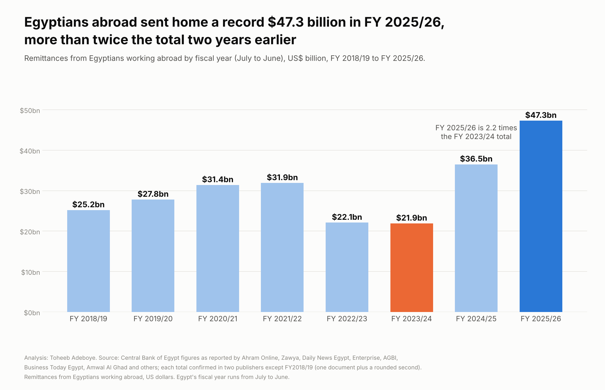
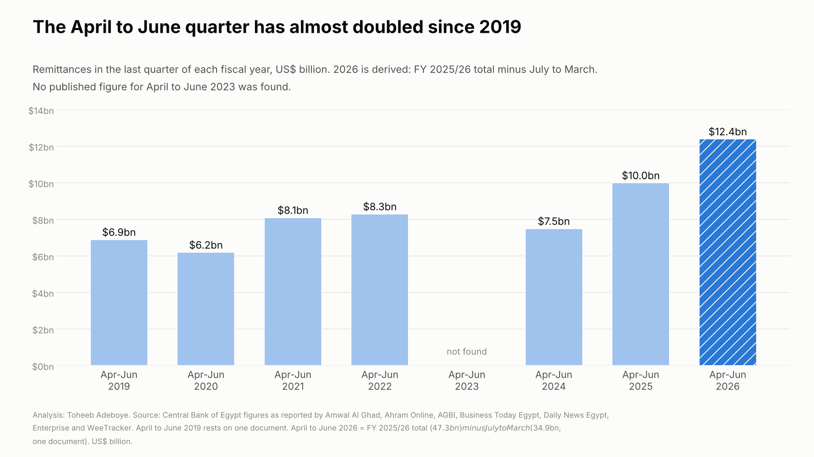

# Egypt Remittances

**How much money do Egyptians working abroad send home each year, and how has the total changed since FY2018/19?**

[Notebook](notebooks/egypt_remittances_analysis.ipynb) · [SQL](sql/analysis_queries.sql) · [Data dictionary](docs/data_dictionary.md) · [Tidy data](data/processed/remittances_tidy.csv)



## Contents

1. [Project background](#project-background)
2. [Questions](#questions)
3. [Executive summary](#executive-summary)
4. [Insights](#insights)
5. [Recommendations](#recommendations)
6. [Data](#data)
7. [Method](#method)
8. [Tools](#tools)
9. [Repository structure](#repository-structure)
10. [How to reproduce](#how-to-reproduce)
11. [Assumptions and limitations](#assumptions-and-limitations)
12. [Sources](#sources)
13. [Author](#author)

## Project background

Egypt is one of the largest receivers of remittances in the world, and many of the senders work in the Gulf. The Central Bank of Egypt (CBE) publishes the total sent home by Egyptians working abroad each month, each quarter and for each fiscal year, which runs from July to June. The bank releases these figures in statements that the Egyptian and regional press reprint.

This project collects those figures from 18 published documents, checks them against each other, and builds one series from FY2018/19 to FY2025/26. It is meant for anyone whose work or household depends on these flows: banks, exchange houses and money transfer firms in the Gulf, businesses selling to Egyptian households, and Egyptian families working abroad who want to see where their own transfers sit in the national total.

## Questions

1. How much did Egyptians abroad send home in each fiscal year from FY2018/19 to FY2025/26?
2. How large was the change in the last two fiscal years?
3. Does the picture change in calendar years instead of fiscal years?
4. How do the latest months and quarters compare with the same period a year earlier?

## Executive summary

| Measure | Value |
|---|---|
| Remittances, FY2025/26 (July 2025 to June 2026) | US$47.3 billion, a record |
| Change on FY2024/25 | +29.6% (from US$36.5 billion) |
| FY2025/26 against FY2023/24 (US$21.9 billion) | 2.16 times, +US$25.4 billion |
| FY2025/26 against the earlier high, FY2021/22 (US$31.9 billion) | +48.3% |
| Calendar 2025 | US$41.5 billion, +40.5% on 2024 (published) |
| April to June 2026 quarter (derived) | US$12.4 billion, against US$10.0 billion a year earlier |
| July 2026, latest month | about US$4.5 billion, +20% on July 2025 (one document) |



Remittances more than doubled in two fiscal years: from US$21.9 billion in FY2023/24 to US$47.3 billion in FY2025/26. The FY2025/26 total is 48% above the earlier high of FY2021/22. The calendar-year view tells the same story with a different size: 2025 was 40.5% above 2024.

## Insights

**1. FY2025/26 set a record of US$47.3 billion, 29.6% above FY2024/25.**

| Fiscal year | US$ billion | Change on year before |
|---|---|---|
| FY2018/19 | 25.2 | |
| FY2019/20 | 27.8 | +10.3% |
| FY2020/21 | 31.4 | +12.9% |
| FY2021/22 | 31.9 | +1.6% |
| FY2022/23 | 22.1 | -30.7% |
| FY2023/24 | 21.9 | -0.9% |
| FY2024/25 | 36.5 | +66.7% |
| FY2025/26 | 47.3 | +29.6% |

Changes are computed from the rounded totals. The CBE's own rates, computed from unrounded figures, are 10.4%, 13%, 1.6%, 66.2% and 29.6%; each one falls inside the range the rounded totals allow (see `data/processed/growth_rate_checks.csv`).

**2. In two years the annual total rose by US$25.4 billion.** FY2025/26 is 2.16 times FY2023/24. The rise began after the exchange-rate unification of March 2024: FY2024/25 was the first full fiscal year after it, and the second year added a further US$10.8 billion.

**3. Measured in calendar years the 2025 rise is larger: +40.5%.** Calendar 2025 (US$41.5 billion) is the second half of FY2024/25 plus the first half of FY2025/26. The figures add up exactly: US$36.5 billion minus US$17.1 billion for July to December 2024, plus US$22.1 billion for July to December 2025, gives US$41.5 billion. The calendar view puts more of the step-up of 2024 and 2025 into one year, which is why it shows a larger rise than the fiscal view.

**4. Growth is slowing but monthly totals keep setting new levels.**

| Month | US$ billion | Same month a year earlier | Change |
|---|---|---|---|
| December 2025 | 4.0 | 3.2 | +24.0% (published) |
| January 2026 | 3.5 | 2.9 | +21% (published) |
| June 2026 | 4.2 | 3.6 | +15.6% (published) |
| July 2026 | 4.5 | 3.8 | +20% (published) |

Year-on-year growth was 40.7% in June 2025 and 15.6% in June 2026. The level is still rising; the rate of growth is lower than in the first year after March 2024.

**5. The April to June quarter has almost doubled since 2019.** It was US$6.9 billion in 2019 and US$12.4 billion in 2026. The 2026 figure is derived: the FY2025/26 total minus the July to March total of US$34.9 billion. The same method applied a year earlier gives US$10.1 billion against a published US$10.0 billion, which supports it.

## Recommendations

For **banks, exchange houses and money transfer firms serving Egyptian workers in the Gulf**:

1. Plan capacity on the current level, not on the FY2022/23 to FY2023/24 trough. Every month published since December 2025 was US$3.5 billion or more, and the April to June 2026 quarter averaged about US$4.1 billion a month.
2. Use the July 2026 figure (about US$4.5 billion, the highest month in the table) as the current reference point for a peak month, until the CBE publishes later months.
3. Watch the growth rate rather than the level. Growth fell from about 40% a year to 15% to 20% a year between mid 2025 and mid 2026. A further slowdown would show first in the monthly CBE releases.

For **businesses selling to households in Egypt**: remittances are now about US$4 billion a month. Spending that depends on money from relatives abroad has a larger base than in any earlier year in this series.

For **Egyptian families abroad**: the national total is a sum of millions of individual transfers. The rise in recorded flows since 2024 is a rise in money passing through banks and licensed channels, which the CBE can count.

## Data

| File | Rows | Content |
|---|---|---|
| `data/raw/remittance_readings.csv` | 79 | Every figure read from every document, one row per figure per document |
| `data/raw/published_growth_rates.csv` | 17 | Growth rates printed in the documents, used as checks |
| `data/raw/sources.csv` | 18 | Publisher, title, date and link of each document |
| `data/processed/remittances_tidy.csv` | 33 | One row per figure after checks, with the number of documents and publishers |
| `data/processed/fiscal_year_series.csv` | 8 | Fiscal-year totals, FY2018/19 to FY2025/26, with changes and an index |
| `data/processed/derived_figures.csv` | 4 | Figures computed from published ones |
| `data/processed/growth_rate_checks.csv` | 17 | Each published rate against the range the rounded values allow |
| `data/processed/identity_checks.csv` | 3 | Accounting identities between figures |
| `data/processed/headline_figures.csv` | 12 | Headline figures used in this README and the chart |

Coverage: Egypt only, FY2018/19 to FY2025/26, plus calendar 2024 and 2025, six April to June quarters, cumulative fiscal-year totals and 12 months.

Checks done:

- No missing values, no duplicate figure-document pairs, all values between US$1.9 and US$47.3 billion.
- The build script stops if two documents give different values for the same figure, except for three readings set aside with a reason written in the raw file.
- Of 33 figures, 24 are printed by at least two publishers, one by one document plus a second that rounds to whole billions, and eight by one document.
- 15 published growth rates fall inside the range allowed by the rounded values; two could not be tested because the comparison month is not in the table.
- Three identities hold: calendar 2025 from the fiscal halves, April to June 2025 from the fiscal year minus July to March, and January 2026 from two cumulative totals.

## Method

Each figure is consolidated across documents; it is accepted only if all documents agree. A growth rate is checked against the range of rates consistent with values rounded to one decimal place:

```
growth_low  = ((new - 0.05) / (old + 0.05) - 1) x 100
growth_high = ((new + 0.05) / (old - 0.05) - 1) x 100
published rate must lie in [growth_low - t, growth_high + t]
  t = 0.05 for a rate printed to one decimal, 0.5 for a whole-number rate

calendar 2025      = (FY2024/25 - Jul-Dec 2024) + Jul-Dec 2025
Apr-Jun quarter    = fiscal-year total - Jul-Mar cumulative total
two-year multiple  = FY2025/26 / FY2023/24
```

The alternative time window (calendar years instead of fiscal years) is reported alongside the main series.

## Tools

Python (pandas, matplotlib) for the build, checks and charts; SQLite for the queries in `sql/`; a Jupyter notebook that reruns the build and asserts the headline figures.

## Repository structure

```
egypt-remittances/
  README.md
  requirements.txt
  data/raw/            readings from each document, published growth rates, source list
  data/processed/      tidy table, fiscal-year series, derived figures, check tables
  notebooks/           egypt_remittances_analysis.ipynb (executed)
  scripts/             build_data.py, make_charts.py
  sql/                 analysis_queries.sql
  images/              egypt-remittances-chart.png, april-june-quarter.png
  docs/                data_dictionary.md
```

## How to reproduce

```
pip install -r requirements.txt
python scripts/build_data.py
python scripts/make_charts.py
```

Then open the notebook. To run the SQL, load `data/processed/remittances_tidy.csv` and `data/processed/fiscal_year_series.csv` into SQLite as tables of the same names.

## Assumptions and limitations

- The CBE's own statistical tables could not be opened, so every figure comes from news reports of CBE releases. Several outlets printing the same release confirm that a number was transcribed correctly; they are not independent measurements.
- Values are rounded to US$0.1 billion in the reports, and some are marked "about". Changes computed here can differ from the CBE's rates by a few tenths of a point.
- FY2023/24 is printed as US$21.9 billion by two publishers and as US$22.1 billion by one. The series uses 21.9, which also matches the CBE's published 66.2% rise to FY2024/25.
- FY2018/19 rests on one document (US$25.2 billion) and a second that rounds it to US$25 billion; the published 10.4% rise to FY2019/20 is consistent with it.
- Earlier years were left out because documents disagree: FY2016/17 is printed as both US$17.5 billion and US$21.9 billion, and FY2017/18 as both US$26.0 and US$26.5 billion.
- The July to February FY2025/26 total (US$29.4 billion) appears in one document only. Together with the neighbouring totals it implies a March 2026 figure of US$5.5 billion that no other document confirms, so it is not used and no single month of February or March 2026 is shown.
- No April to June 2023 figure was found; the quarter chart leaves the bar empty.
- The figures count transfers through banks and licensed channels. Money carried in cash or sent through informal channels is not counted, and the share of each can change over time, above all around a change in exchange-rate arrangements.
- The analysis does not split the total by sending country; the CBE releases used here do not give that breakdown.

## Sources

Central Bank of Egypt figures, as reported by:

- Amwal Al Ghad, [Remittances from Egyptian expats record $27.8bln by FY2019/20 end](https://en.amwalalghad.com/?p=114968), August 2020
- Enterprise, [Current account deficit widens to USD 8.2 bn in FY 2018-2019](https://enterpriseam.com/egypt/2019/10/01/current-account-deficit-widens-to-usd-8-2-bn-in-fy-2018-2019/), 1 October 2019
- Ahram Online, [Egyptian expats' remittances jumps by 70% in 8 fiscal years](https://english.ahram.org.eg/News/426633.aspx), 10 October 2021
- AGBI, [Remittances from Egyptian expats rises 1.6% to $31.9bn](https://www.agbi.com/economy/2022/08/remittances-from-egyptian-expats-rises-1-6-to-31-9bn/), August 2022
- Business Today Egypt, [Egyptian expats remittances hit $31.9 billion in FY 2021/2022](https://www.businesstodayegypt.com/amp/1/1680/Egyptian-expats-remittances-hit-31-9-billion-in-FY-2021), 23 August 2022
- Al-Monitor, [Egypt remittances plunge amid economic uncertainty](https://al-monitor.com/originals/2023/06/egypt-remittances-plunge-amid-economic-uncertainty), June 2023
- Amwal Al Ghad, [Egypt ranks 6th globally in receiving expat remittances in '22/'23](https://en.amwalalghad.com/?p=163658), 24 June 2024
- Daily News Egypt, [Egypt sees record $36.5bn in remittances during FY2024/25](https://www.dailynewsegypt.com/?p=836488), August 2025
- Enterprise, [Remittances from Egyptians abroad hit record high of USD 36.5 bn in FY 24-25](https://enterpriseam.com/egypt/2025/08/27/remittances-from-egyptians-abroad-hit-record-high-of-usd-36-5-bn-in-fy-24-25/), 27 August 2025
- WeeTracker, [Egyptian Remittances Double in Ten Years and Surge 66% in One Year](https://weetracker.com/2025/10/02/egyptian-remittances-double-in-ten-years-and-surge-66-in-one-year/), 2 October 2025
- Amwal Al Ghad, [Egypt's remittances at strongest in 2025, 40% YoY up](https://en.amwalalghad.com/?p=225496), 23 February 2026
- Business Today Egypt, [Egypt remittances rise 28.4% to $25.6B in July-January](https://www.businesstodayegypt.com/amp/1/7214/Egypt-remittances-rise-28-4-to-25-6B-in-July–January), 24 March 2026
- Intelpoint, [Egypt received a record $41.5bn in remittances in 2025](https://intelpoint.co/insights/egypt-received-a-record-41-5bn-in-remittances-in-2025-31-7-above-the-previous-record-set-in-2021/), 2026
- Ahram Online, [Egypt's expat remittances jump 32% to $34.9 bln in first 9 months of FY25/26](https://english.ahram.org.eg/News/569944.aspx), 1 June 2026
- Zawya, [Egypt's remittances hit record $47.3bln in FY2025/26](https://www.zawya.com/en/economy/north-africa/egypts-remittances-hit-record-47.3bln-in-fy202526-cbe-462932), August 2026
- The Star (Xinhua), [Egyptian expat remittances hit record 47.3 bln USD in FY 2025-2026](https://www.thestar.com.my/news/world/2026/08/21/egyptian-expat-remittances-hit-record-473-bln-usd-in-fy-2025-2026), 21 August 2026
- Arab Finance, [Egypt remittances hit record in FY 2025/2026](https://www.arabfinance.com/en/news/newdetails/egypt-remittances-hit-record-in-fy-2025-2026), August 2026
- Egypt Today, [Egyptians' remittances rise 28.1% to $29.7B in seven months](https://www.egypttoday.com/Article/3/149620/Egyptians%E2%80%99-remittances-rise-28-1-to-29-7B-in-seven), 21 September 2026

## Author

Toheeb Adeboye, Data Analyst, Doha, Qatar. [LinkedIn](https://www.linkedin.com/in/dtsquarea/)
