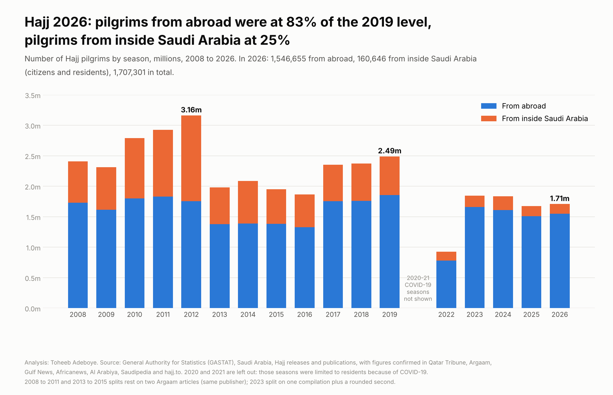
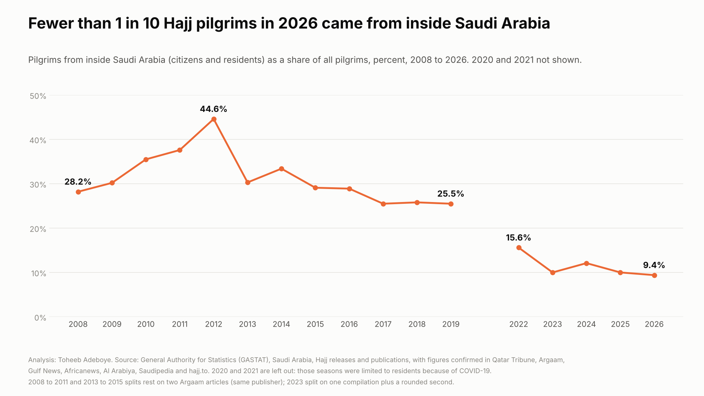

# Hajj Pilgrims by Year

**How many pilgrims performed Hajj in 2026, how does that compare with 2019, and how has the split between pilgrims from abroad and pilgrims from inside Saudi Arabia changed since 2008?**

[Notebook](notebooks/hajj_pilgrims_analysis.ipynb) · [SQL](sql/analysis_queries.sql) · [Data dictionary](docs/data_dictionary.md) · [Tidy data](data/processed/pilgrims_tidy.csv)



## Contents

1. [Project background](#project-background)
2. [Questions](#questions)
3. [Executive summary](#executive-summary)
4. [Insights](#insights)
5. [Recommendations](#recommendations)
6. [Data](#data)
7. [Method](#method)
8. [Tools](#tools)
9. [Repository structure](#repository-structure)
10. [How to reproduce](#how-to-reproduce)
11. [Assumptions and limitations](#assumptions-and-limitations)
12. [Sources](#sources)
13. [Author](#author)

## Project background

Every year the General Authority for Statistics (GASTAT) of Saudi Arabia counts the pilgrims who perform Hajj. It publishes two groups: pilgrims who arrive from abroad through air, land and sea entry points ("external"), and pilgrims who are citizens or residents of Saudi Arabia ("internal"). The count is released on the day of Arafat and repeated in a statistical publication.

Hajj is one of the largest annual movements of people in the world, and the size of each group matters to airlines, travel and Hajj operators, hotels and transport firms in Makkah and Madinah, and to families across the world, including Gulf residents, who plan a pilgrimage. This project collects the GASTAT counts for every season from 2008 to 2026 from 21 documents, checks them against each other, and builds one series.

## Questions

1. How many pilgrims performed Hajj in 2026, and how does that compare with 2025, 2019 and the 2012 peak?
2. How close is each group, from abroad and from inside Saudi Arabia, to its 2019 level?
3. How has the share of pilgrims from inside Saudi Arabia changed since 2008?
4. Where do pilgrims from abroad come from, and how do they travel?

## Executive summary

| Measure | Value |
|---|---|
| Pilgrims, Hajj 2026 | 1,707,301 |
| Change on 2025 (1,673,230) | +2.0% |
| From abroad, 2026 | 1,546,655, 83.4% of the 2019 level |
| From inside Saudi Arabia, 2026 | 160,646, 25.3% of the 2019 level |
| All pilgrims, 2026 against 2019 (2,489,406) | 68.6% |
| Share from inside Saudi Arabia | 9.4% in 2026, 25.5% in 2019, 44.6% in 2012 |
| Female share of all pilgrims | 47.7% in 2026, 44.4% in 2019 |
| Pilgrims from abroad arriving by air, 2026 | 96.1% |



Hajj 2026 drew 1.71 million pilgrims, 2.0% more than in 2025. Pilgrims from abroad are close to their pre-COVID level: 83.4% of 2019 and 88.2% of the 2012 figure. Pilgrims from inside Saudi Arabia are at a quarter of their 2019 level, and fewer than one pilgrim in ten now comes from inside the country.

## Insights

**1. 1,707,301 pilgrims performed Hajj in 2026, 2.0% more than in 2025.** It is the first rise after two seasons of decline.

| Season | All pilgrims | Change on previous season | Against 2019 |
|---|---|---|---|
| 2019 | 2,489,406 | +5.0% | 100.0% |
| 2022 | 926,062 | | 37.2% |
| 2023 | 1,845,045 | +99.2% | 74.1% |
| 2024 | 1,833,164 | -0.6% | 73.6% |
| 2025 | 1,673,230 | -8.7% | 67.2% |
| 2026 | 1,707,301 | +2.0% | 68.6% |

2020 and 2021 are not in the table: those seasons were limited to residents because of COVID-19 (about 1,000 pilgrims in 2020, about 58,500 in 2021).

**2. Pilgrims from abroad are at 83.4% of their 2019 level.** 1,546,655 arrived from abroad in 2026, 2.7% more than in 2025 and 88.2% of the 2012 figure (1,752,932). Between 2013 and 2016 the number from abroad was between 1.33 and 1.39 million a season; 2026 is above every one of those years.

| Season | From abroad | Against 2019 |
|---|---|---|
| 2019 | 1,855,027 | 100.0% |
| 2023 | 1,660,915 | 89.5% |
| 2024 | 1,611,310 | 86.9% |
| 2025 | 1,506,576 | 81.2% |
| 2026 | 1,546,655 | 83.4% |

**3. Pilgrims from inside Saudi Arabia are at 25.3% of their 2019 level.** 160,646 citizens and residents performed Hajj in 2026, 3.6% fewer than in 2025. Leaving out the COVID-19 seasons, only 2022 (144,653) was lower since 2008. Of the 782,105 fewer pilgrims in 2026 than in 2019, 473,733 (60.6%) are pilgrims from inside the country and 308,372 are pilgrims from abroad.

**4. The share of pilgrims from inside Saudi Arabia fell from 44.6% in 2012 to 25.5% in 2019 and 9.4% in 2026.** The share was 28% to 38% from 2008 to 2011, peaked in 2012, and settled at about a quarter from 2017 to 2019. Since 2023 it has been between 9.4% and 12.1%.

**5. About one pilgrim from abroad in four comes from an Arab country, and about three in five from non-Arab Asia.**

| Origin of pilgrims from abroad | 2017 | 2018 | 2019 | 2024 |
|---|---|---|---|---|
| Arab countries, including the GCC | 23.8% | 24.4% | 24.1% | 22.3% |
| of which GCC countries | 1.9% | 1.9% | 1.7% | |
| Non-Arab Asia | 59.5% | 59.7% | 60.7% | 63.3% |
| Non-Arab Africa | 10.7% | 9.4% | 10.1% | 11.3% |
| Europe, the Americas and Australia | 6.1% | 6.4% | 5.0% | 3.2% |

Shares for 2017 to 2019 are computed from the published counts; 2024 shares are as printed by GASTAT, which did not publish the counts or say whether its "Arab countries" group includes the GCC. The 2025 and 2026 releases do not give the breakdown.

**6. Women made up 47.7% of pilgrims in 2026, against 44.4% in 2019.** In 2026, 96.1% of pilgrims from abroad arrived by air, 3.5% by land and 0.4% by sea.

## Recommendations

For **airlines, travel firms and licensed Hajj operators**: plan on a base of about 1.5 to 1.7 million pilgrims from abroad a season. That is the range of every season from 2023 to 2026. Nearly all of them (96.1% in 2026) fly, so air capacity is the main part of the market to plan around.

For **hotels, transport and catering firms in Makkah and Madinah**: the total is about 1.7 million, against 2.5 million in 2019. Nine in ten pilgrims now come from abroad, so demand follows the arrival schedule of international groups rather than the last-minute arrivals of residents.

For **pilgrims and families planning Hajj, including residents of Qatar and the Gulf**: pilgrims from GCC countries travel as pilgrims from abroad and made up about 2% of that group from 2017 to 2019. Places are allocated through each country's own Hajj arrangements, so the national authority in the country of residence is the first place to look.

For **analysts following the season**: the GASTAT count on the day of Arafat is the one figure published every year in the same form. The breakdown by origin, published until 2019 and in shares in 2024, is the gap in the public data.

## Data

| File | Rows | Content |
|---|---|---|
| `data/raw/pilgrim_readings.csv` | 210 | Every figure read from every document, one row per figure per document |
| `data/raw/origin_readings.csv` | 28 | Pilgrims from abroad by origin group, 2017, 2018, 2019 (counts) and 2024 (shares) |
| `data/raw/sources.csv` | 21 | Publisher, title, date and link of each document |
| `data/processed/figures_checked.csv` | 84 | One row per figure after checks, with the number of documents and publishers |
| `data/processed/pilgrims_by_year.csv` | 17 | Total, from abroad and from inside Saudi Arabia by season, 2008 to 2026 without 2020 and 2021 |
| `data/processed/pilgrims_tidy.csv` | 34 | Long table for Power BI or Tableau: one row per season and pilgrim group |
| `data/processed/external_by_origin.csv` | 22 | Origin shares of pilgrims from abroad |
| `data/processed/identity_checks.csv` | 30 | Accounting identities between published figures |
| `data/processed/headline_figures.csv` | 22 | Headline figures used in this README and the charts |

Coverage: Saudi Arabia, Hajj seasons 2008 to 2026. 2020 and 2021 are kept in the raw file but left out of the series.

Checks done:

- No missing values and no duplicate figure-document pairs. The build script stops if two documents print different values for the same figure.
- Four readings are set aside with a reason in the raw file: the 2020 and 2021 totals (COVID-19 seasons; two documents also disagree on 2021) and one sea-arrivals figure for 2024 (4,741 in the GASTAT release against 4,714 in the GASTAT publication; only 4,714 makes the three arrival modes add up to the external total).
- Of 84 figures, 43 are printed by at least two publishers, 22 by two documents of the same publisher, two by one document plus a second that rounds them, and 17 by one document.
- 30 identities hold exactly: internal plus external equals the total in all 17 seasons, male plus female equals the total in six, and air plus land plus sea equals the external total in seven.
- The computed change for 2019 (+5.0%) matches the +4.96% printed by GASTAT, and 2018 (+0.8%) matches the +1% printed by Argaam.

## Method

Each figure is consolidated across documents and accepted only if all documents agree. Comparisons use 2019, the last season before COVID-19 limits, as the base:

```
internal_share_pct      = internal / total x 100
group_pct_of_2019       = group in season / group in 2019 x 100
change_pct              = (season / previous season - 1) x 100   (only when the previous calendar year is in the series)
internal share of gap   = (internal 2026 - internal 2019) / (total 2026 - total 2019) x 100

identities: internal + external = total
            male + female = total
            air + land + sea = external
```

The alternative base, the 2012 peak, is reported alongside 2019 for the total and for pilgrims from abroad.

## Tools

Python (pandas, matplotlib) for the build, checks and charts; SQLite for the queries in `sql/`; a Jupyter notebook that reruns the build and asserts the headline figures.

## Repository structure

```
hajj-pilgrims-by-year/
  README.md
  requirements.txt
  data/raw/            readings from each document, origin readings, source list
  data/processed/      checked figures, series by season, tidy table, origin shares, checks, headline figures
  notebooks/           hajj_pilgrims_analysis.ipynb (executed)
  scripts/             build_data.py, make_charts.py
  sql/                 analysis_queries.sql
  images/              hajj-pilgrims-chart.png, internal-share.png
  docs/                data_dictionary.md
```

## How to reproduce

```
pip install -r requirements.txt
python scripts/build_data.py
python scripts/make_charts.py
```

Then open the notebook. To run the SQL, load `data/processed/pilgrims_by_year.csv` and `data/processed/pilgrims_tidy.csv` into SQLite as tables of the same names.

## Assumptions and limitations

- "From inside Saudi Arabia" (internal) covers citizens and residents of any nationality. "From abroad" (external) counts arrivals through entry points, so GCC citizens and other pilgrims living outside Saudi Arabia are external.
- Several outlets printing the same GASTAT release confirm that a number was transcribed correctly; they are not independent measurements. The splits for 2008 to 2011 and 2013 to 2015 rest on two Argaam articles (same publisher); the totals for those years are confirmed by Saudipedia and Gulf News. The 2023 split rests on one compilation (hajj.to) plus rounded figures in Argaam; the 2023 total is also in Saudipedia.
- The 2019 origin counts add up to 1,854,627, 400 fewer than the published external total. Origin shares are computed on the sum of the groups.
- The 2024 origin shares are as printed, without counts, and GASTAT does not say whether its "Arab countries" group includes the GCC. They are shown next to 2017 to 2019 for orientation, not as an exact comparison.
- A Daily FT report from 2014 implies 1,380,508 pilgrims from abroad in 2013 (1,389,053 less a printed increase of 8,545), against 1,379,531 in Argaam. The Argaam figure is used; the difference (977) is less than 0.1%.
- The data counts pilgrims, not the reasons behind changes from season to season. The analysis does not explain why either group rose or fell.

## Sources

General Authority for Statistics (GASTAT), Saudi Arabia:

- [GASTAT: Total number of pilgrims for Hajj 2026 reaches (1,707,301)](https://stats.gov.sa/en/w/news/194), 26 May 2026
- [GASTAT: Total number of pilgrims performing Hajj 1446H (2025) reaches (1,673,230)](https://www.stats.gov.sa/en/w/news/49), 5 June 2025
- [Hajj Statistics Publication 2025](https://www.stats.gov.sa/documents/d/guest/hajj-statistics-publication-2025en-1-pdf)
- [GASTAT: Total number of pilgrims in 1445 H Hajj season is 1,833,164](https://stats.gov.sa/en/news/532), June 2024
- [Hajj Statistics Publication 2024](https://www.stats.gov.sa/documents/20117/2067030/Hajj+Statistics+Publication+2024EN.pdf/ee9e1b69-731b-9976-b394-e24ec4bf6f72)
- [GASTAT announces total number of Umrah performers and pilgrims for 1443 (2022)](https://www.stats.gov.sa/en/news/463), June 2023
- [Hajj Statistics 2022](https://www.al-kanz.org/wp-content/uploads/Hajj-Statistics-2022.pdf) (copy hosted by Al-Kanz)
- [GASTAT: The total number of pilgrims for the 1440 AH Hajj season is 2,489,406](https://www.stats.gov.sa/en/w/gastat-the-total-number-of-pilgrims-for-the-1440-ah-hajj-season-is-2-489-406-an-increase-of-4.96-from-last-year-the-kingdom-has-provided-over-350-thousand-employees-to-serve-them), 18 August 2019
- [GASTAT: The total number of pilgrims in 1439H Hajj season reached 2,371,675 pilgrims](https://www.stats.gov.sa/en/w/gastat-the-total-number-of-pilgrims-in-1439h-hajj-season-reached-2.371.675-pilgrims), 20 August 2018

GASTAT figures as reported or compiled by:

- Qatar Tribune, [This Hajj season sees over 1707300 pilgrims](https://www.qatar-tribune.com/article/236305/world/this-hajj-season-sees-over-1707300-pilgrims), 27 May 2026
- hajj.to, [Hajj and Umrah Statistics: Pilgrims by Year](https://hajj.to/data), 2026
- Saudipedia, [Timeline of the Number of Pilgrims from 1970 to 2025](https://saudipedia.com/en/timeline-of-the-number-of-pilgrims-from-1970-to-2025)
- Argaam, [Number of pilgrims hits 1.85 mln in Hajj season 2023: GASTAT](https://www.argaam.com/en/article/articledetail/id/1653897), 28 June 2023
- Argaam, [A look at Hajj pilgrimage over 10 years](https://www.argaam.com/en/article/articledetail/id/1308120), 10 August 2019
- Argaam, [A look at the Hajj pilgrimage over the years](https://www.argaam.com/en/article/articledetail/id/566598), 19 August 2018
- Africanews, [African pilgrims constituted 9.5% of 2018 Hajj population](https://www.africanews.com/2018/09/05/african-pilgrims-constituted-95-percent-of-2018-hajj-population-official/), 5 September 2018
- Al Arabiya, [Over a million women pilgrims perform the Hajj this year](https://english.alarabiya.net/News/gulf/2017/09/07/Over-a-million-women-pilgrims-perform-the-Hajj-this-year), 7 September 2017
- Gulf News, [1.8 million foreigners arrive for Haj](https://gulfnews.com/amp/story/world%2Fgulf%2Fsaudi%2F18-million-foreigners-arrive-for-haj-1.2081800), 29 August 2017
- Gulf News, [3,161,573 are performing Haj this year](https://gulfnews.com/world/gulf/saudi/3161573-are-performing-haj-this-year-1.1094476)
- Sunni Online, [Hajj 2016: 1.8 million pilgrims the smallest number in 10 years](https://sunnionline.us/english/2016/09/21/6526/), 21 September 2016
- Daily FT, [Over 2 million prepare for Haj climax](https://www.ft.lk/News/over-2-million-prepare-for-haj-climax/56-359039), 4 October 2014

## Author

Toheeb Adeboye, Data Analyst, Doha, Qatar. [LinkedIn](https://www.linkedin.com/in/dtsquarea/)
