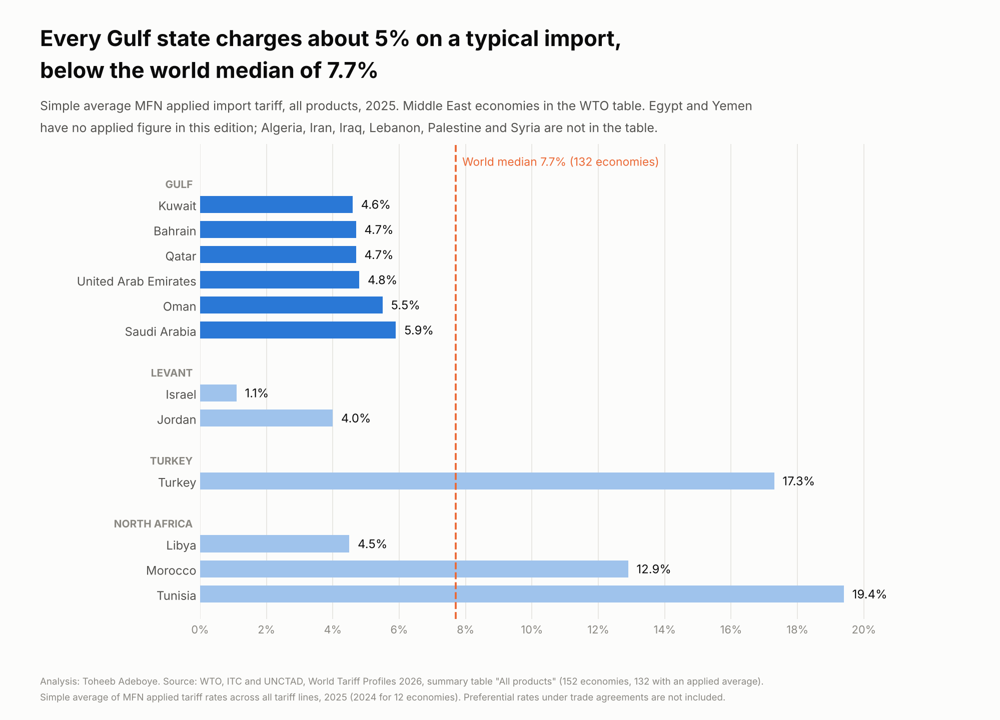
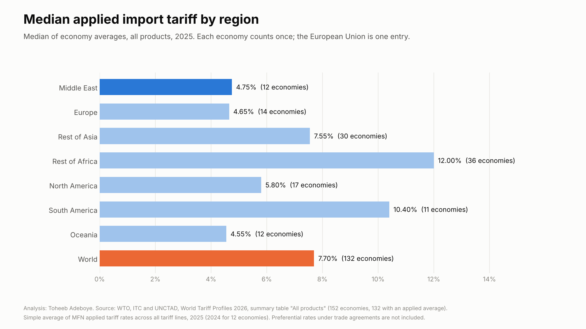

# Import Tariffs by Country

**What rate of import duty does a typical product face entering each Middle East economy, and how does the region compare with the rest of the world?**

[Notebook](notebooks/import_tariffs_analysis.ipynb) · [SQL](sql/analysis_queries.sql) · [Data dictionary](docs/data_dictionary.md) · [Tidy data](data/processed/tariffs_tidy.csv)



## Contents

1. [Project background](#project-background)
2. [Questions](#questions)
3. [Executive summary](#executive-summary)
4. [Insights](#insights)
5. [Recommendations](#recommendations)
6. [Data](#data)
7. [Method](#method)
8. [Tools](#tools)
9. [Repository structure](#repository-structure)
10. [How to reproduce](#how-to-reproduce)
11. [Assumptions and limitations](#assumptions-and-limitations)
12. [Sources](#sources)
13. [Author](#author)

## Project background

Every product that crosses a border meets a customs tariff. The rate an economy applies to imports from all WTO members, unless a trade agreement gives a lower one, is its MFN (most favoured nation) applied rate. Each year the WTO, the International Trade Centre and UNCTAD publish *World Tariff Profiles*, which sums up each economy's tariff schedule in a few numbers. The 2026 edition, released in July 2026, covers 152 economies and gives 2025 rates for most of them.

This project takes the "All products" summary table, puts the Middle East first and compares it with the other regions. It is meant for anyone who prices goods across borders: exporters, importers, distributors and people setting up a business in the region.

## Questions

1. What is the simple average applied tariff in each Middle East economy in the table?
2. How do the six Gulf states compare with each other and with the world?
3. How does the Middle East compare with the other regions?
4. Does the answer change if the European Union is counted as 27 economies instead of one?

## Executive summary

| Measure | Value |
|---|---|
| Economies in the table / with an applied average | 152 / 132 |
| World median of economy averages | 7.70% |
| Gulf states, range | 4.6% (Kuwait) to 5.9% (Saudi Arabia) |
| Gulf mean | 5.03% |
| Middle East economies with a figure | 12 of 20 |
| Middle East range | 1.1% (Israel) to 19.4% (Tunisia) |
| Economies with a higher average than Saudi Arabia | 84 of 132 |
| World median with the EU as 27 members | 6.40% |



All six Gulf states apply a simple average of 4.6% to 5.9%, below the world median of 7.70%. Outside the Gulf the region spreads widely: Israel's 1.1% is the 8th lowest of 132 economies, and Tunisia's 19.4% is the second highest after the Bahamas.

## Insights

**1. Every Gulf state sits between 4.6% and 5.9%, below the world median.**

| Economy | Average applied tariff, 2025 | Economies with a higher average (of 132) |
|---|---|---|
| Kuwait | 4.6% | 103 |
| Bahrain | 4.7% | 101 |
| Qatar | 4.7% | 101 |
| United Arab Emirates | 4.8% | 100 |
| Oman | 5.5% | 89 |
| Saudi Arabia | 5.9% | 84 |

The six states share a customs union with a common external tariff, so their averages differ by little more than one point.

**2. The rest of the Middle East ranges from 1.1% to 19.4%.**

| Economy | Average applied tariff, 2025 | Rank, lowest first (of 132) |
|---|---|---|
| Israel | 1.1% | 8 |
| Jordan | 4.0% | 24 |
| Libya | 4.5% | 28 |
| Morocco | 12.9% | 115 |
| Turkey | 17.3% | 127 |
| Tunisia | 19.4% | 131 |

Egypt and Yemen are in the table but have no applied figure in this edition. Algeria, Iran, Iraq, Lebanon, Palestine and Syria are not in the table.

**3. By region, the Middle East median is close to Europe's and well below Africa's and South America's.**

| Region | Economies | Median | Mean |
|---|---|---|---|
| Middle East | 12 | 4.75% | 7.45% |
| Europe (EU as one) | 14 | 4.65% | 4.97% |
| Rest of Asia | 30 | 7.55% | 7.09% |
| Rest of Africa | 36 | 12.00% | 11.84% |
| North America | 17 | 5.80% | 8.36% |
| South America | 11 | 10.40% | 9.35% |
| Oceania | 12 | 4.55% | 5.49% |
| World | 132 | 7.70% | 8.40% |

The Middle East mean (7.45%) is far above its median because Tunisia, Turkey and Morocco pull it up.

**4. Counting the EU as 27 members lowers the world median to 6.40%, and every Gulf state is still below it.**

## Recommendations

For **exporters and distributors selling into the region**:

1. Treat about 5% as the starting point for duty on most goods entering any Gulf state, then check the product line: the average hides products charged much more or nothing at all.
2. For Turkey, Tunisia and Morocco, check whether your goods qualify for a trade agreement rate before pricing. Their averages of 12.9% to 19.4% apply to goods that do not qualify for a preference.
3. Use the median, not the mean, when comparing regions. A few high-tariff economies move the mean of a small region a lot.

## Data

| File | Rows | Content |
|---|---|---|
| `data/raw/wtp2026_all_products_reading_a.txt` | 151 | Reading A of the summary table, every number on each row |
| `data/raw/wtp2026_all_products_reading_b.txt` | 152 | Reading B from a second copy, first four numbers on each row |
| `data/raw/wto_ttd_profiles.csv` | 10 | Second WTO document: Tariff & Trade Data country profiles |
| `data/raw/country_reference.csv` | 202 | Country, ISO code and region |
| `data/raw/sources.csv` | 4 | Source links |
| `data/processed/tariffs_tidy.csv` | 152 | One row per economy, tidy table for Power BI or Tableau |
| `data/processed/middle_east.csv` | 20 | The 20 Middle East economies, with those missing from the table marked |
| `data/processed/region_summary.csv` | 11 | Economies, mean, median, min and max by region, with the EU alternative |
| `data/processed/source_checks.csv` | 10 | Table value against the WTO country profile |

Coverage: 152 economies in the table, 132 with an applied average (120 for 2025, 12 for 2024). 12 of 20 Middle East economies have a figure.

Checks done in `scripts/build_data.py`:

- Two readings of the table, from two copies of the report, agree on year, bound average and applied average for all 151 economies they share. Chinese Taipei appears in reading B only.
- No duplicate economies; every applied average lies between 0% and 100%.
- Each row is classified by the count of printed numbers (member with an applied rate, non-member, member without one), and the build stops on a row that fits no type.
- WTO country profiles confirm the same value and year for Qatar, Kuwait and Bahrain, and the same value under another year label for Saudi Arabia and Libya. For the UAE, Oman and Turkey the profile shows an earlier year with a value 0.1 to 0.2 points away.

## Method

The measure is the one WTO publishes: the simple average of MFN applied ad valorem duties (with ad valorem equivalents where WTO computes them) across all tariff lines of the economy's schedule.

```
economy average  = sum of MFN applied rates over tariff lines / number of tariff lines      (published by WTO)
region median    = median of economy averages in the region, each economy counted once
rank             = position from lowest to highest among the 132 economies with a figure (ties share a rank)
economies higher = count of economies with a strictly higher average
```

Alternative: the EU counted as 27 members, each with the EU's 4.9%.

## Tools

Python (pandas, matplotlib), SQL (SQLite), Jupyter notebook.

## Repository structure

```
import-tariffs-by-country/
  README.md
  requirements.txt
  data/raw/                 two readings of the WTO table, WTO profiles, reference and sources
  data/processed/           tidy table, Middle East table, region summary, source checks
  notebooks/                import_tariffs_analysis.ipynb, executed
  scripts/build_data.py     builds data/processed from data/raw
  scripts/make_charts.py    draws the charts in images/
  sql/analysis_queries.sql  queries on the tidy table
  images/                   charts
  docs/data_dictionary.md   every column of every file
```

## How to reproduce

```
pip install -r requirements.txt
python scripts/build_data.py
python scripts/make_charts.py
```

Then open the notebook. The SQL file runs on `data/processed/tariffs_tidy.csv` loaded as a table named `tariffs`.

## Assumptions and limitations

- A simple average counts every tariff line equally, whether the product is traded a lot or not at all. It is not the duty paid on actual imports. The trade-weighted average is not used here.
- MFN rates are the rates charged when no trade agreement applies. Trade inside the Gulf customs union, the Greater Arab Free Trade Area and agreements with the EU and others often pays less or nothing.
- The table does not include anti-dumping duties, safeguards, temporary additional duties or other charges collected at the border, so for some economies the duty paid in 2025 and 2026 was higher than the MFN average.
- 12 economies report 2024 rather than 2025.
- Both readings come from the same publication. The second WTO document (country profiles) covers only 10 economies and does not always show the same year. Figures for Israel, Jordan, Morocco and Tunisia (2025) and Turkey (2025) rest on the WTO report alone.
- The report's PDF text leaves blank cells out. Rows were read by the count of numbers; a row with an unusual blank could be misread, though both readings agree.
- Eight of the 20 Middle East economies have no applied figure in this edition.

## Sources

- WTO, ITC and UNCTAD (2026). *World Tariff Profiles 2026*. Copies read: [worldtradescanner.com](https://worldtradescanner.com/tariffprofiles2026.pdf) and [poder360.com.br](https://static.poder360.com.br/uploads/2026/07/tariff-profiles-2026.pdf).
- WTO Tariff & Trade Data, country profiles, for example [Qatar](https://ttd.wto.org/en/profiles/qatar), [Saudi Arabia](https://ttd.wto.org/en/profiles/saudi-arabia-kingdom-of), [Kuwait](https://ttd.wto.org/en/profiles/kuwait-the-state-of), [Bahrain](https://ttd.wto.org/en/profiles/bahrain-kingdom-of). Read on 13 October 2026.

## Author

Toheeb Adeboye, Data Analyst, Doha, Qatar. [LinkedIn](https://www.linkedin.com/in/dtsquarea/)
