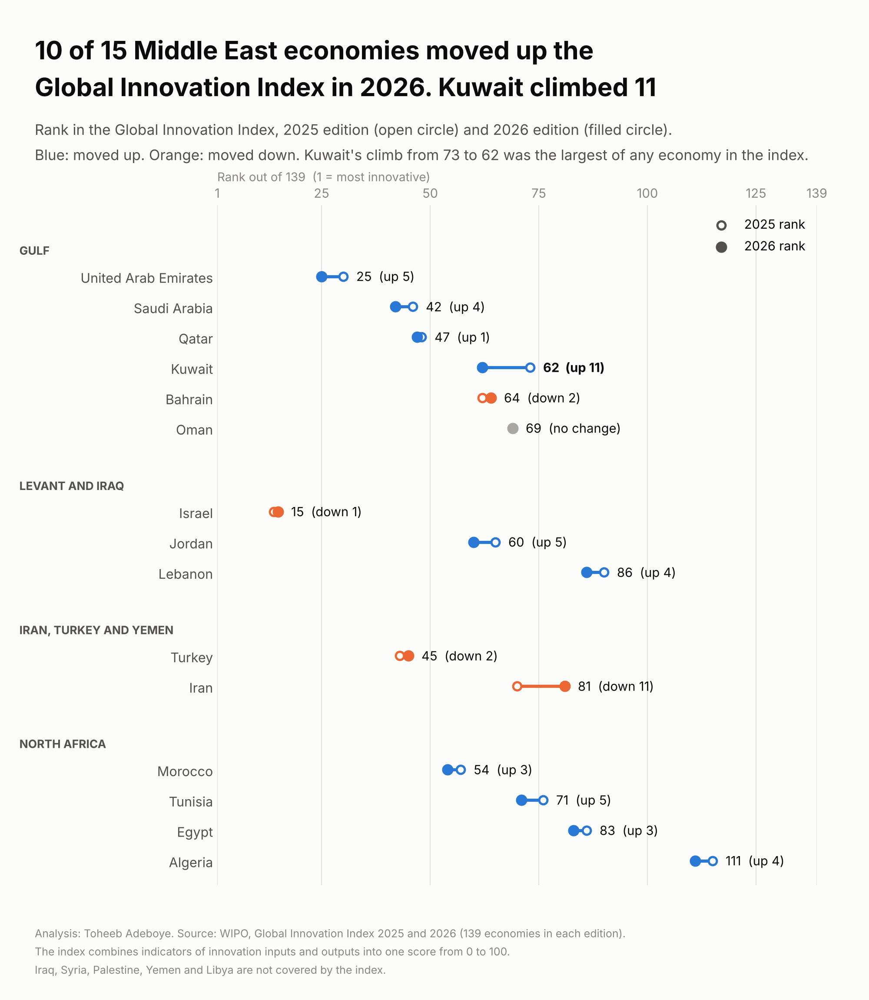
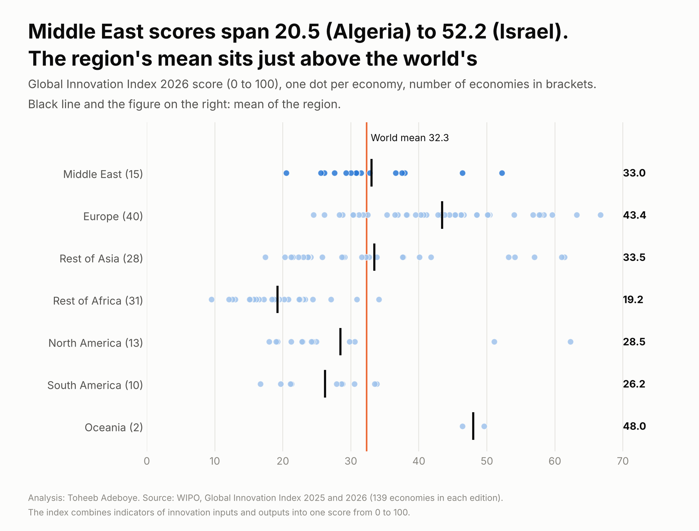

# Innovation Index by Country

**Where does each Middle East economy rank in the Global Innovation Index 2026, which of them moved up since 2025, and how does the region compare with the rest of the world?**

[Notebook](notebooks/innovation_index_analysis.ipynb) · [SQL queries](sql/analysis_queries.sql) · [Data dictionary](docs/data_dictionary.md) · [Tidy data](data/processed/gii_tidy.csv)



## Contents

1. [Project background](#project-background)
2. [Questions](#questions)
3. [Executive summary](#executive-summary)
4. [Insights](#insights)
5. [Recommendations](#recommendations)
6. [Data](#data)
7. [Method](#method)
8. [Tools](#tools)
9. [Repository structure](#repository-structure)
10. [How to reproduce](#how-to-reproduce)
11. [Assumptions and limitations](#assumptions-and-limitations)
12. [Sources](#sources)
13. [Author](#author)

## Project background

Companies deciding where to place a research team, a regional office or a startup, and people choosing where to build a career in technology, often start from a ranking of innovation. The most widely used one is the Global Innovation Index (GII), published every year by the World Intellectual Property Organization (WIPO), a United Nations agency. It combines indicators of innovation inputs (institutions, skills and research, infrastructure, markets, business) and outputs (knowledge and technology, creative outputs) into one score from 0 to 100 for each economy.

The 2026 edition was released at the end of September 2026 and covers 139 economies. This project puts the 15 Middle East economies in the index first, compares their ranks with the 2025 edition, and then sets the region against the rest of the world.

## Questions

1. Where does each Gulf state rank in 2026, and how did its rank change from 2025?
2. Which Middle East economies moved up, and which moved down?
3. How does the Middle East compare with Europe, Asia, Africa, the Americas and Oceania?
4. Does the answer change if WIPO's own regional grouping is used instead?
5. How many of the figures can be confirmed in a second document?

## Executive summary

Ten of the 15 Middle East economies in the index ranked higher in 2026 than in 2025, four ranked lower and one kept its place. Kuwait climbed 11 places, from 73rd to 62nd, the largest climb of any of the 136 economies that appear in both editions. The United Arab Emirates rose five places to 25th, the highest Gulf rank, and Saudi Arabia rose four places to 42nd. Israel, 15th, is the highest-ranked economy in the region. The region's mean score, 33.05, sits just above the world mean of 32.32.

| Measure | Value |
|---|---|
| Middle East economies in the index | 15 of 20 (Iraq, Syria, Palestine, Yemen and Libya are not covered) |
| Moved up / down / unchanged, 2025 to 2026 | 10 / 4 / 1 |
| Largest climb of any economy | Kuwait, 73rd to 62nd (+11) |
| Highest Gulf rank | United Arab Emirates, 25th (30th in 2025) |
| Gulf ranks 2026 | UAE 25, Saudi Arabia 42, Qatar 47, Kuwait 62, Bahrain 64, Oman 69 |
| Middle East mean score 2026 | 33.05 (world mean 32.32) |
| Middle East economies in the world top 50 | 5 (Israel, UAE, Saudi Arabia, Turkey, Qatar) |



## Insights

### 1. Four of the six Gulf states moved up

| Economy | Rank 2025 | Rank 2026 | Change | Score 2026 |
|---|---|---|---|---|
| United Arab Emirates | 30 | 25 | up 5 | 46.4 |
| Saudi Arabia | 46 | 42 | up 4 | 37.9 |
| Qatar | 48 | 47 | up 1 | 36.6 |
| Kuwait | 73 | 62 | up 11 | 30.9 |
| Bahrain | 62 | 64 | down 2 | 30.8 |
| Oman | 69 | 69 | no change | 30.0 |

Kuwait passed Bahrain in 2026. The two now sit two places apart, with scores of 30.9 and 30.8. Oman's rank did not change, but WIPO's profile reported in the press shows its innovation input rank rising eight places to 47th.

### 2. Kuwait's climb was the largest in the whole index

Of the 136 economies in both editions, the ten largest climbs were Kuwait (+11), Azerbaijan (+9), Venezuela (+9), Kazakhstan, Bosnia and Herzegovina and Rwanda (+8 each), and Cambodia, Ecuador, Trinidad and Tobago and Madagascar (+7 each).

### 3. Outside the Gulf, every North African economy moved up

| Sub-region | Economy | Rank 2025 | Rank 2026 | Change |
|---|---|---|---|---|
| Levant | Israel | 14 | 15 | down 1 |
| Levant | Jordan | 65 | 60 | up 5 |
| Levant | Lebanon | 90 | 86 | up 4 |
| Iran and Turkey | Turkey | 43 | 45 | down 2 |
| Iran and Turkey | Iran | 70 | 81 | down 11 |
| North Africa | Morocco | 57 | 54 | up 3 |
| North Africa | Tunisia | 76 | 71 | up 5 |
| North Africa | Egypt | 86 | 83 | up 3 |
| North Africa | Algeria | 115 | 111 | up 4 |

### 4. The Middle East sits in the middle of the world table

| Region | Economies | Mean score 2026 | In top 50 | Highest rank |
|---|---|---|---|---|
| Middle East | 15 | 33.05 | 5 | Israel, 15 |
| Europe | 40 | 43.42 | 31 | Switzerland, 1 |
| Rest of Asia | 28 | 33.46 | 9 | South Korea, 4 |
| Rest of Africa | 31 | 19.20 | 1 | Mauritius, 50 |
| North America (with Central America and the Caribbean) | 13 | 28.49 | 2 | United States, 3 |
| South America | 10 | 26.19 | 0 | Chile, 51 |
| Oceania | 2 | 48.00 | 2 | Australia, 20 |
| World | 139 | 32.32 | 50 | Switzerland, 1 |

Six of the 15 Middle East economies score above the world mean: Israel, the United Arab Emirates, Saudi Arabia, Turkey, Qatar and Morocco. Scores in the region run from 20.5 (Algeria) to 52.2 (Israel).

### 5. The result holds under WIPO's own grouping

WIPO groups 18 economies as Northern Africa and Western Asia. It adds Cyprus, Georgia, Armenia and Azerbaijan and places Iran in Central and Southern Asia. Under that grouping, 11 of 18 moved up, 5 moved down and 2 kept their rank, and the mean score is 33.50. The United Arab Emirates ranks second in WIPO's region, after Israel.

## Recommendations

For **companies choosing a regional base for research, product or technology teams**:

- The United Arab Emirates (25th) is the only Gulf state in the world top 30, and Saudi Arabia (42nd) and Qatar (47th) are in the top 50. Start a regional shortlist there, then compare the pillar ranks in each WIPO economy profile against what the team needs (skills, infrastructure or market access).
- Kuwait (11 places) and the United Arab Emirates, Jordan and Tunisia (5 places each) moved up most in the region in one edition. Read their economy profiles for which indicators changed before treating one year's climb as a trend.

For **job seekers and students in technology and research**:

- Use the rank as a starting point, not a verdict. Two economies a few places apart, such as Kuwait (62nd, 30.9) and Bahrain (64th, 30.8), score almost the same.

For **analysts using the index**:

- Compare ranks across editions, not scores. Between 2025 and 2026, 110 of 136 economies' scores rose, with a mean change of +0.88, so part of any score change comes from the edition itself.

## Data

| File | Rows | What it holds |
|---|---|---|
| `data/raw/gii_2026_reading_a.csv` | 139 | GII 2026 table, first reading (CSV) |
| `data/raw/gii_2026_reading_b.csv` | 139 | GII 2026 table, second reading, same document |
| `data/raw/gii_2026_web_page_ranks.csv` | 77 | 2026 ranks named in the text of WIPO's GII 2026 results web page |
| `data/raw/gii_2025_wipo.csv` | 139 | GII 2025 table, WIPO executive version |
| `data/raw/gii_2025_wikipedia.csv` | 139 | GII 2025 table as printed on Wikipedia |
| `data/raw/published_figures.csv` | 16 | Ranks printed in news reports and a WIPO economy profile |
| `data/raw/country_reference.csv` | 199 | Region and Middle East sub-region used across this portfolio |
| `data/raw/sources.csv` | 7 | Source links |
| `data/processed/gii_tidy.csv` | 139 | One row per economy: 2026 and 2025 score and rank, change, region, check status |
| `data/processed/middle_east.csv` | 15 | Middle East economies, Gulf first |
| `data/processed/region_summary.csv` | 13 | World, regions, Middle East sub-regions and WIPO's region |
| `data/processed/source_checks.csv` | 16 | Each published figure set against the table |

Coverage: 139 economies in each edition. 136 appear in both; Bhutan, Chad and the Democratic Republic of the Congo are new in 2026, and Seychelles, Guinea and the Republic of the Congo were in 2025 only.

Checks done by the build script, which stops on any failure:

- Each table has 139 rows, ranks 1 to 139, no duplicates and scores between 0 and 100.
- In each table a lower rank never carries a higher score. A misread digit breaks this.
- The two readings of the 2026 table agree on every score, rank and region rank.
- WIPO's region rank equals the order of 2026 ranks among the 18 economies of its region.
- All 77 ranks named in the text of WIPO's results web page match the 2026 table.
- All 16 ranks printed in Muscat Daily, Arab News and the WIPO economy profile match the tables.
- The 2025 WIPO table and Wikipedia agree for 134 of 139 economies. The five differences are listed in the build script: two pairs of economies tied at one decimal and printed in the other order (Cyprus and New Zealand, Kenya and Paraguay), and Cambodia's score (22.0 against 21.9). The WIPO figure is used. None is a Middle East economy.

## Method

The rank change compares each economy's place in two editions. A positive number means the economy moved up.

```
rank_change  = rank_2025 - rank_2026
score_change = score_2026 - score_2025
region mean  = sum(score_2026 of economies in the region) / number of economies in the region
```

Regions follow the grouping used across this portfolio: 20 Middle East economies (six Gulf states; Levant and Iraq; Iran, Turkey and Yemen; North Africa), Europe, Rest of Asia, Rest of Africa, North America with Central America and the Caribbean, South America and Oceania. Fifteen of the 20 Middle East economies are in the index. The alternative grouping is WIPO's region, Northern Africa and Western Asia.

## Tools

Python (pandas, matplotlib), SQL (tested in SQLite), Jupyter notebook.

## Repository structure

```
innovation-index-by-country/
  README.md
  requirements.txt
  data/raw/                  two readings of the 2026 table, two sources for 2025, published figures, sources
  data/processed/            gii_tidy.csv and summary tables
  notebooks/                 innovation_index_analysis.ipynb, executed
  scripts/                   build_data.py, make_charts.py
  sql/                       analysis_queries.sql
  images/                    two charts
  docs/data_dictionary.md
```

## How to reproduce

```
pip install -r requirements.txt
python scripts/build_data.py
python scripts/make_charts.py
```

The SQL file runs on `data/processed/gii_tidy.csv` loaded as a table named `gii_tidy`.

## Assumptions and limitations

- The index is a composite. It weights many indicators into one score, and the choice of indicators and weights is WIPO's. A rank says where an economy sits on that measure, not how innovative every sector or city in it is.
- WIPO revises indicators and data sources between editions, and the set of economies changes. Rank changes from one edition to the next partly reflect those changes. A one-year move of a few places is small.
- The 2026 scores rest on one document, WIPO's GII 2026 executive version, read twice. The two readings agree, and the ranks of 77 economies, including all 15 in the Middle East, are confirmed by the WIPO results web page; the Gulf ranks are also confirmed by Muscat Daily. The scores of the 62 economies not named on the web page rest on the executive version alone.
- News reports reprint WIPO's own figures. Agreement shows the figures were transcribed correctly. It is not an independent measurement.
- Iraq, Syria, Palestine, Yemen and Libya are not in the index, so the Middle East figures cover 15 of the 20 economies used elsewhere in this portfolio.
- Scores are printed to one decimal. Where two economies print the same score, the order between them comes from WIPO's unrounded figures.

## Sources

- WIPO, [Global Innovation Index 2026, Executive Version](https://www.wipo.int/web-publications/global-innovation-index-2026-executive-version/assets/87166/2000-GII-2026%20Executive%20Version%20-%20EN_150dpi.pdf), rankings table on page 7.
- WIPO, [GII 2026 results](https://www.wipo.int/web-publications-preview/global-innovation-index-2026/en/gii-2026-results.html), web publication.
- WIPO, [GII 2026 economy profile: United Arab Emirates](https://www.wipo.int/edocs/gii-ranking/2026/ae.pdf).
- WIPO, [Global Innovation Index 2025, Executive Version](https://tind.wipo.int/record/58871/files/wipo-pub-2000-2025-exec-en-global-innovation-index-2025%5B1%5D.pdf).
- Wikipedia, [Global Innovation Index](https://en.wikipedia.org/wiki/Global_Innovation_Index), 2025 table.
- Muscat Daily, [Oman ranks 69th in Global Innovation Index 2026](https://www.muscatdaily.com/2026/09/29/oman-ranks-69th-in-global-innovation-index-2026/), 29 September 2026.
- Arab News, [Saudi Arabia climbs to 46th in UN Global Innovation Index](https://www.arabnews.com/node/2615632/business-economy), 2025 edition.

## Author

**Toheeb Adeboye**, Data Analyst, Doha, Qatar. [LinkedIn](https://www.linkedin.com/in/dtsquarea/)
