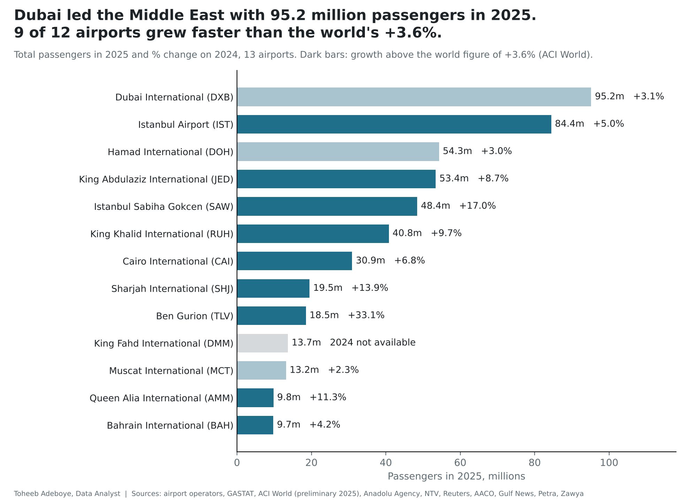
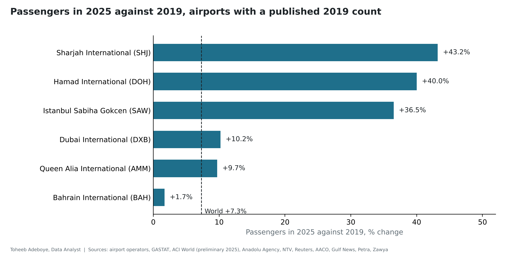

# Middle East Airport Passengers 2025

**How many passengers did each major Middle East airport handle in 2025, which grew fastest, and how does the region compare with the world's busiest airports?**

[Notebook](notebooks/airport_passengers_analysis.ipynb) · [SQL](sql/analysis_queries.sql) · [Data dictionary](docs/data_dictionary.md) · [Tidy data](data/processed/passengers_tidy.csv)



## Contents

1. [Project background](#project-background)
2. [Questions](#questions)
3. [Executive summary](#executive-summary)
4. [Insights](#insights)
5. [Recommendations](#recommendations)
6. [Data](#data)
7. [Method](#method)
8. [Tools](#tools)
9. [Repository structure](#repository-structure)
10. [How to reproduce](#how-to-reproduce)
11. [Assumptions and limitations](#assumptions-and-limitations)
12. [Sources](#sources)
13. [Author](#author)

## Project background

Airports publish their passenger counts each January, and Airports Council International (ACI World) publishes a world ranking each spring. The figures are spread across operator releases, statistics offices and news reports, and they are rarely set side by side. This project collects the 2025 counts for 13 of the largest airports in the Gulf, the Levant, North Africa and Turkey, with 2024 and 2019 where a count was published, from 56 documents. Every figure was checked against a second document where one exists.

The numbers matter to airlines, travel agencies, airport retailers, hotel groups and logistics firms deciding where demand is growing, and to travellers choosing between hubs. 2025 is the last full year before the airspace disruption of 2026, so it is a clean base year for later comparisons.

## Questions

1. Which Middle East airports handled the most passengers in 2025?
2. How fast did each grow on 2024, and how many grew faster than the world?
3. How far above 2019 are the airports that published a 2019 count?
4. Where do Middle East airports stand among the world's busiest?

## Executive summary

| Measure | Value |
|---|---|
| Dubai International (DXB), 2025 | 95,192,160 passengers, +3.1% on 2024 |
| DXB in the world | 2nd by total passengers, 1st by international passengers |
| Middle East airports in the world top 10 (total) | 2: Dubai (2nd) and Istanbul (8th, 84.4 million) |
| Airports growing faster than the world (+3.6%) | 9 of 12 with a 2024 figure |
| Fastest growth on 2024 | Ben Gurion +33.1%, Sabiha Gokcen +17.0%, Sharjah +13.9%, Queen Alia +11.3% |
| Hamad International (DOH) against 2019 | +40.0% (54.3 million against 38.8 million) |
| 12 airports together, 2025 on 2024 | +7.7% |
| 7 Gulf airports together, 2025 on 2024 | +5.7% |



Dubai stayed the busiest airport in the region and the busiest in the world for international travel. Dubai and Doha grew more slowly than the world in 2025, but both are well above their 2019 size: Doha by 40.0% and Dubai by 10.2%. Most of the growth in 2025 came from airports in Saudi Arabia, Sharjah, Istanbul's second airport, Amman and Tel Aviv.

## Insights

**1. Dubai handled 95.2 million passengers, second in the world after Atlanta (106.3 million) and first for international passengers.** Istanbul Airport was eighth in the world with 84.4 million.

| Rank | Airport | Passengers 2025 (millions) | Change on 2024 |
|---|---|---|---|
| 1 | Dubai International (DXB) | 95.19 | +3.1% |
| 2 | Istanbul Airport (IST) | 84.44 | +5.0% |
| 3 | Hamad International, Doha (DOH) | 54.30 | +3.0% |
| 4 | King Abdulaziz International, Jeddah (JED) | 53.40 | +8.7% |
| 5 | Istanbul Sabiha Gokcen (SAW) | 48.42 | +17.0% |
| 6 | King Khalid International, Riyadh (RUH) | 40.80 | +9.7% |
| 7 | Cairo International (CAI) | 30.94 | +6.8% |
| 8 | Sharjah International (SHJ) | 19.48 | +13.9% |
| 9 | Ben Gurion, Tel Aviv (TLV) | 18.50 | +33.1% |
| 10 | King Fahd International, Dammam (DMM) | 13.70 | no 2024 figure |
| 11 | Muscat International (MCT) | 13.16 | +2.3% |
| 12 | Queen Alia International, Amman (AMM) | 9.79 | +11.3% |
| 13 | Bahrain International (BAH) | 9.74 | +4.2% |

**2. 9 of the 12 airports with a 2024 figure grew faster than the world's +3.6%.** Dubai (+3.1%), Doha (+3.0%) and Muscat (+2.3%) grew more slowly. Ben Gurion's +33.1% is a recovery from a low 2024.

**3. Three airports are 35% to 45% larger than in 2019.** Sharjah +43.2%, Doha +40.0% and Sabiha Gokcen +36.5%, against +7.3% for the world (ACI World). Dubai is +10.2%, Amman +9.7% and Bahrain +1.7%.

**4. By subregion, the two Levant airports grew 24.6%, Istanbul's two airports 9.1%, Cairo 6.8% and seven Gulf airports 5.7%.**

| Subregion | Airports | Passengers 2025 | Change on 2024 |
|---|---|---|---|
| Gulf | 7 (DMM has no 2024 figure) | 286,069,719 | +5.7% |
| Turkey (Istanbul) | 2 | 132,858,467 | +9.1% |
| North Africa (Cairo) | 1 | 30,944,269 | +6.8% |
| Levant | 2 | 28,289,851 | +24.6% |

**World context.** In ACI World's preliminary 2025 ranking, the top 10 by total passengers hold four North American airports, three in Asia-Pacific, two in the Middle East (Dubai, Istanbul) and one in Europe (London Heathrow). The international top 10 holds three Middle East airports (Dubai 1st, Istanbul 6th, Doha 10th with 54,338,667 international passengers), four European and three in Asia-Pacific.

## Recommendations

For airlines, travel firms and airport retailers planning routes or space in the region:

1. Treat Dubai and Doha as large, mature markets: they added 2.9 million and 1.6 million passengers in 2025, at a rate close to the world's.
2. Look at the airports growing two to five times faster than the world for new capacity: Riyadh and Jeddah (about 3.6 and 4.3 million more passengers each), Sharjah, Sabiha Gokcen and Amman.
3. Use 2025 as the base year when measuring 2026, and compare like with like: operator counts with operator counts, ACI with ACI.

## Data

| File | Rows | Content |
|---|---|---|
| data/raw/passenger_readings.csv | 80 | Every figure from every document, as printed |
| data/raw/sources.csv | 56 | Documents with links and dates |
| data/raw/world_top10_2025.csv | 20 | ACI World top 10, total and international |
| data/processed/figures_checked.csv | 35 | Chosen figure per airport, year and measure, with check status |
| data/processed/passengers_tidy.csv | 31 | Tidy table: airport, year, passengers |
| data/processed/airports_2025.csv | 13 | One row per airport with 2019, 2024, 2025 and changes |
| data/processed/headline_figures.csv | 21 | Headline figures checked by the notebook |

Coverage: 8 Gulf airports (Dubai, Doha, Jeddah, Riyadh, Sharjah, Dammam, Muscat, Bahrain), 2 in the Levant (Tel Aviv, Amman), Cairo, and Istanbul's two airports. 2024 figures for 12 airports, 2019 figures for 6.

Checks done: no duplicate airport-year rows; every reading agrees with the chosen figure within the rounding it was printed with, or the build fails; lower bounds ("more than 48 million") must be below the chosen figure; Muscat's international and domestic counts for 2024 add up to the printed total of 12.9 million; the notebook recomputes every headline figure and asserts it matches.

## Method

For each airport and year, the most precise reading is chosen and every other reading is tested against it:

```
agree   = |chosen - reading| <= rounding_unit / 2
change  = (passengers_2025 / passengers_base - 1) x 100,   base = 2024 or 2019
above   = change_vs_2024 > 3.6   (ACI World, total passengers, preliminary 2025)
group change = sum(2025) / sum(2024) - 1, airports with both years only
```

Readings printed before the year ended, forecasts, and combined figures for several airports are recorded but not used.

## Tools

Python (pandas, matplotlib), SQL (SQLite), Jupyter notebook.

## Repository structure

```
middle-east-airport-passengers/
  README.md
  requirements.txt
  data/raw/            passenger_readings.csv, sources.csv, world_top10_2025.csv
  data/processed/      figures_checked.csv, passengers_tidy.csv, airports_2025.csv, world_top10_2025.csv, headline_figures.csv
  notebooks/           airport_passengers_analysis.ipynb
  scripts/             build_data.py, make_charts.py
  sql/                 analysis_queries.sql
  images/              middle-east-airports-2025.png, change-vs-2019.png
  docs/                data_dictionary.md
```

## How to reproduce

```
pip install -r requirements.txt
python scripts/build_data.py
python scripts/make_charts.py
cd notebooks && jupyter nbconvert --execute --to notebook --inplace airport_passengers_analysis.ipynb
```

The SQL file runs on `passengers_tidy.csv` loaded as a table named `passengers_tidy`.

## Assumptions and limitations

- Sources count passengers differently. Istanbul's 2025 figure is ACI's (84,437,710); the national count printed by NTV is 84,457,421. Its 2024 base (80.4 million) is the national count, which gives +5.0%; ACI prints +5.5% on its own 2024 base.
- Riyadh's 2024 figure (37.2 million) rests on one document and gives +9.7%; GASTAT, as reported by Arab News, prints +8.7% for 2025. Either way the airport grew faster than the world.
- Jeddah 2025: the operator prints 53.4 million and GASTAT 53.5 million. The operator figure is used.
- Single-document figures: Sabiha Gokcen 2025 (48,420,757, NTV; Anadolu printed "more than 48 million" before year end); Ben Gurion 2025 (18.5 million) and 2024 (13.9 million), Reuters citing the Israel Airports Authority; Riyadh 2024; Amman 2024.
- Muscat's 2025 total (13,157,559) is derived from international and domestic counts; no single total was printed.
- Not covered: Abu Dhabi Zayed International (only a combined figure for the emirate's five airports is published, printed as both 32.5 million and "more than 33 million"), Kuwait (no 2025 figure found), Madinah (approximate figure only). The 2019 figures for the Saudi airports, Cairo and Muscat were not found; Istanbul Airport opened in April 2019, so 2019 is not comparable.
- Several news outlets repeating one airport release confirm the transcription, not an independent count.
- The world figures are ACI's preliminary release of April 2026. ACI's final release in July 2026 revised world growth on 2024 from +3.6% to +3.7%; the count of airports above the world figure is the same with either.

## Sources

Airport operators and authorities: Dubai Airports and Dubai Media Office, Hamad International Airport, King Abdulaziz International Airport, Sharjah Airport, Airport International Group (Queen Alia), Bahrain Ministry of Transportation and Telecommunications, General Authority for Statistics (Saudi Arabia), General Authority of Civil Aviation (Saudi Arabia), ACI World. Publishers: CNN, Gulf News, Khaleej Times, Qatar Tribune, Gulf Times, Anadolu Agency, NTV, Reuters, Arab News, Arab Air Carriers Organization, Petra, Zawya, Moodie Davitt Report, APA, Business Today Egypt, Gulf Daily News and others. Every document with its link is in [data/raw/sources.csv](data/raw/sources.csv).

## Author

Toheeb Adeboye, Data Analyst, Doha, Qatar. [LinkedIn](https://www.linkedin.com/in/dtsquarea/)
