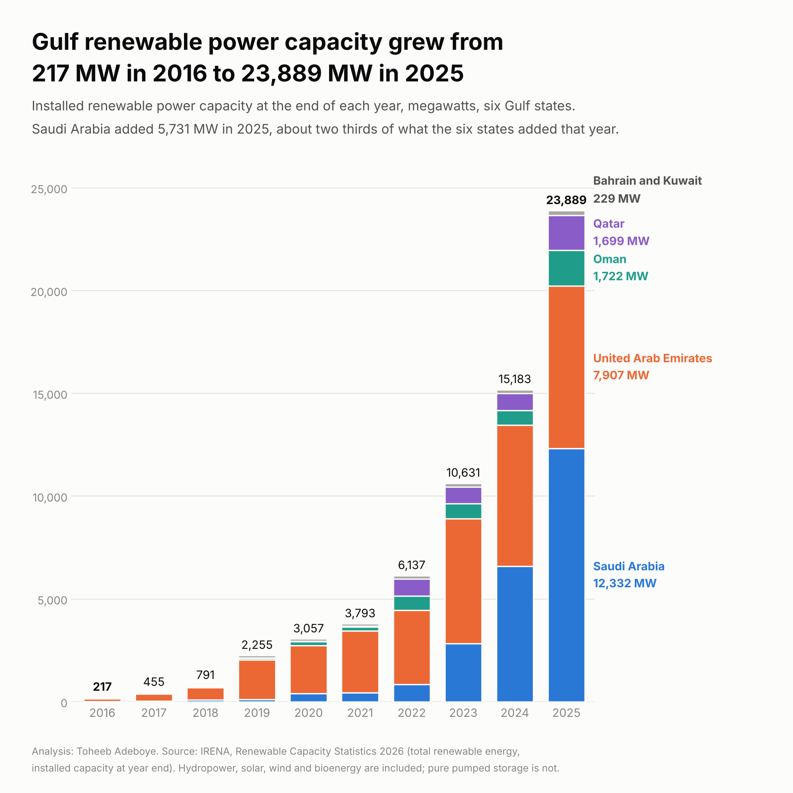
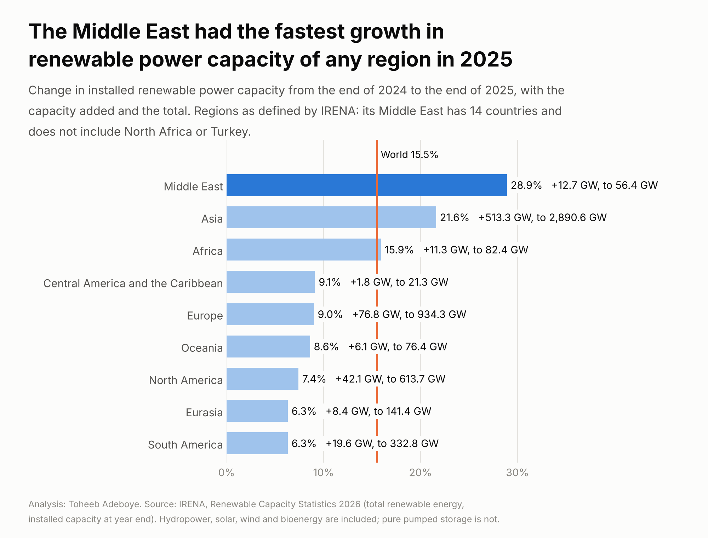
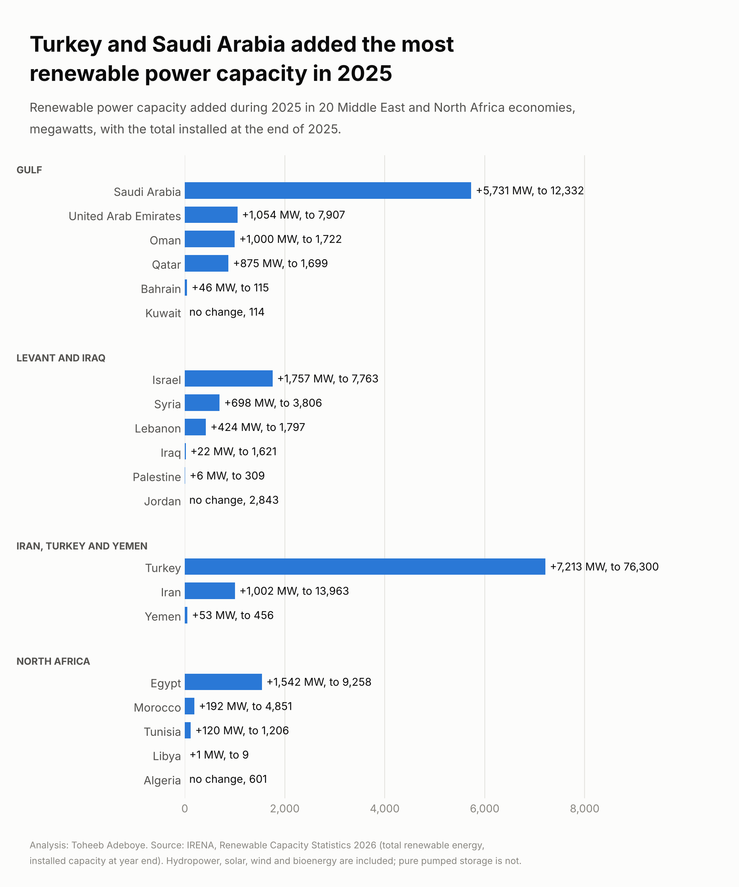

# Renewable Power Capacity by Country

**How much renewable power capacity does each Middle East economy have, how fast did it grow in 2025, and how does the region compare with the rest of the world?**

[Notebook](notebooks/renewable_capacity_analysis.ipynb) · [SQL queries](sql/analysis_queries.sql) · [Data dictionary](docs/data_dictionary.md) · [Tidy data](data/processed/renewable_capacity_tidy.csv)



## Contents

1. [Project background](#project-background)
2. [Questions](#questions)
3. [Executive summary](#executive-summary)
4. [Insights](#insights)
5. [Recommendations](#recommendations)
6. [Data](#data)
7. [Method](#method)
8. [Tools](#tools)
9. [Repository structure](#repository-structure)
10. [How to reproduce](#how-to-reproduce)
11. [Assumptions and limitations](#assumptions-and-limitations)
12. [Sources](#sources)
13. [Author](#author)

## Project background

Solar panel suppliers, engineering contractors, lenders and people looking for work in energy all need to know where power plants are being built. The International Renewable Energy Agency (IRENA) publishes the installed renewable power capacity of every country each year. This project takes the 2026 edition, which runs from 2016 to the end of 2025, puts 20 Middle East and North Africa economies first, and then sets the region against the other regions of the world.

## Questions

1. How much renewable power capacity do the six Gulf states have, and how has it changed since 2016?
2. Which of the 20 economies added the most capacity in 2025?
3. How do the Gulf, the Levant, North Africa and the rest of the region compare?
4. How does growth in the Middle East compare with Asia, Africa, Europe, the Americas and Oceania?
5. How many of the figures can be confirmed in a second document?

## Executive summary

The six Gulf states had 217 MW of renewable power capacity between them at the end of 2016 and 23,889 MW at the end of 2025. They added 8,706 MW in 2025 alone, and Saudi Arabia accounted for 5,731 MW of that. In IRENA's regional table the Middle East grew by 28.9% in 2025, the fastest of the nine regions, against 15.5% for the world. The region is still small in absolute terms: 56,446 MW is 1.1% of world capacity.

| Measure | Value |
|---|---|
| Gulf capacity, end of 2016 | 217 MW |
| Gulf capacity, end of 2025 | 23,889 MW |
| Gulf capacity added in 2025 | 8,706 MW (+57.3%) |
| Saudi Arabia, end of 2024 to end of 2025 | 6,601 MW to 12,332 MW (+86.8%) |
| IRENA Middle East (14 countries), growth in 2025 | 28.9%, from 43,778 MW to 56,446 MW |
| World, growth in 2025 | 15.5%, from 4,457,340 MW to 5,149,280 MW |
| 20 Middle East and North Africa economies, end of 2025 | 148,672 MW (+17.1%) |
| 2025 figures also printed in a second document | 11 of 20 economies |



## Insights

### 1. Gulf capacity is 110 times what it was in 2016

| Year end | 2016 | 2018 | 2020 | 2022 | 2023 | 2024 | 2025 |
|---|---|---|---|---|---|---|---|
| Gulf capacity, MW | 217 | 791 | 3,057 | 6,137 | 10,631 | 15,183 | 23,889 |

The total passed 10,000 MW in 2023 and added more in 2025 (8,706 MW) than the six states had in total at the end of 2022.

### 2. Saudi Arabia added 5,731 MW in 2025, close to its whole capacity a year earlier

| Gulf state | End of 2024, MW | End of 2025, MW | Added in 2025, MW | Growth | Share of Gulf additions |
|---|---|---|---|---|---|
| Saudi Arabia | 6,601 | 12,332 | 5,731 | 86.8% | 65.8% |
| United Arab Emirates | 6,853 | 7,907 | 1,054 | 15.4% | 12.1% |
| Oman | 722 | 1,722 | 1,000 | 138.5% | 11.5% |
| Qatar | 824 | 1,699 | 875 | 106.2% | 10.1% |
| Bahrain | 69 | 115 | 46 | 66.7% | 0.5% |
| Kuwait | 114 | 114 | 0 | 0.0% | 0.0% |

Saudi Arabia passed the United Arab Emirates in 2025 and is now the largest in the Gulf. Oman and Qatar each more than doubled.

### 3. Turkey and Saudi Arabia added the most among the 20 economies



Turkey added 7,213 MW and holds 76,300 MW, which is 51.3% of the 20-economy total. Israel (1,757 MW), Egypt (1,542 MW), the United Arab Emirates (1,054 MW), Iran (1,002 MW) and Oman (1,000 MW) each added 1,000 MW or more. The table shows no change in 2025 for Jordan, Algeria and Kuwait.

### 4. The Gulf grew fastest of the four sub-regions

| Sub-region | Economies | End of 2016, MW | End of 2024, MW | End of 2025, MW | Added in 2025, MW | Growth in 2025 |
|---|---|---|---|---|---|---|
| Gulf | 6 | 217 | 15,183 | 23,889 | 8,706 | 57.3% |
| Levant and Iraq | 6 | 5,636 | 15,232 | 18,139 | 2,907 | 19.1% |
| Iran, Turkey and Yemen | 3 | 45,310 | 82,451 | 90,719 | 8,268 | 10.0% |
| North Africa | 5 | 6,943 | 14,070 | 15,925 | 1,855 | 13.2% |
| All 20 economies | 20 | 58,106 | 126,936 | 148,672 | 21,736 | 17.1% |

At the end of 2024 the Gulf and the Levant and Iraq group were level at about 15,200 MW. A year later the Gulf was 5,750 MW ahead.

### 5. The Middle East was the fastest-growing region in 2025, and one of the smallest

| Region (IRENA definition) | End of 2024, MW | End of 2025, MW | Added in 2025, MW | Growth | Share of world, 2025 |
|---|---|---|---|---|---|
| Middle East | 43,778 | 56,446 | 12,668 | 28.9% | 1.10% |
| Asia | 2,377,266 | 2,890,615 | 513,349 | 21.6% | 56.14% |
| Africa | 71,091 | 82,371 | 11,280 | 15.9% | 1.60% |
| Central America and the Caribbean | 19,492 | 21,265 | 1,773 | 9.1% | 0.41% |
| Europe | 857,563 | 934,334 | 76,771 | 9.0% | 18.14% |
| Oceania | 70,322 | 76,383 | 6,061 | 8.6% | 1.48% |
| North America | 571,632 | 613,690 | 42,058 | 7.4% | 11.92% |
| Eurasia | 133,058 | 141,409 | 8,351 | 6.3% | 2.75% |
| South America | 313,139 | 332,767 | 19,628 | 6.3% | 6.46% |
| World | 4,457,340 | 5,149,280 | 691,940 | 15.5% | 100% |

IRENA's Middle East has 14 countries. It counts North Africa in Africa and Turkey in Eurasia. Saudi Arabia accounts for 45.2% of what the IRENA Middle East added in 2025. Since 2016 the Middle East has grown 3.4 times and the world 2.5 times.

### 6. Most figures can be checked against a second document

| Check | Result |
|---|---|
| Two readings of the IRENA table | 220 of 220 cells equal (22 rows, 10 years) |
| IRENA Middle East total against the sum of its 14 countries | Within 2 MW in all 10 years |
| World total against the sum of the nine regions | Within 2 MW in all 10 years |
| Rounded figures in the IRENA press release and two news reports | 35 of 35 agree |
| Capacity added in 2025, Arab Energy Organisation annual report | 6 of 7 agree |

The one difference is the United Arab Emirates: the Arab Energy Organisation gives 1.3 GW added in 2025 and the IRENA table gives 1,054 MW.

## Recommendations

**For equipment suppliers and engineering contractors:** rank markets by capacity added, not by capacity installed. Saudi Arabia added 5.4 times as much as the United Arab Emirates in 2025 although the two hold capacity of the same order.

**For job seekers in energy:** the Gulf added 8,706 MW in one year. Saudi Arabia, the United Arab Emirates, Oman and Qatar each added between 875 MW and 5,731 MW, so these four are where project roles in the Gulf are most likely to be.

**For investors and lenders comparing regions:** read the growth rate with the base. The Middle East grew fastest in 2025 but added 12,668 MW, while Asia added 513,349 MW.

**For analysts reusing this table:** filter on `check_status = 'two-publishers'` when a country figure will be quoted, and state which definition of the Middle East is used.

## Data

| File | Rows | Content |
|---|---|---|
| `data/raw/irena_2026_total_renewable_reading_b.csv` | 31 | World, ten regional rows and 20 countries, 2016 to 2025, second reading of the table |
| `data/raw/irena_2026_total_renewable_reading_a.csv` | 22 | World, Middle East and 20 countries, 2016 to 2025, first reading of the same table |
| `data/raw/secondary_reports.csv` | 42 | Figures printed in the IRENA press release, two news reports and the Arab Energy Organisation report |
| `data/processed/renewable_capacity_tidy.csv` | 350 | One row per country, group or region per year, with the yearly change |
| `data/processed/country_summary_2025.csv` | 20 | One row per economy: 2016, 2024 and 2025 capacity, additions, growth, check status |
| `data/processed/group_summary.csv` | 15 | Four sub-regions, the 20-economy total, nine IRENA regions and the world |
| `data/processed/secondary_checks.csv` | 42 | Each secondary figure next to the value computed from the IRENA table |

Coverage: 20 economies. Gulf 6 (Bahrain, Kuwait, Oman, Qatar, Saudi Arabia, United Arab Emirates), Levant and Iraq 6 (Iraq, Israel, Jordan, Lebanon, Palestine, Syria), Iran, Turkey and Yemen 3, North Africa 5 (Algeria, Egypt, Libya, Morocco, Tunisia). Nine IRENA regions and the world for comparison.

Checks done:

- The table was read twice and the two readings agree on all 220 shared cells.
- No missing values, no duplicate rows, no negative values.
- The Middle East total equals the sum of its 14 countries to within 2 MW in every year, and the world total equals the sum of the nine regions to within 2 MW. Every figure is rounded to a whole megawatt, which explains gaps of that size.
- 41 of 42 secondary figures agree with the table. The build stops if any other figure disagrees.

## Method

Descriptive comparison of installed capacity at year end.

```
added in 2025 (MW)   = capacity at end of 2025 - capacity at end of 2024
growth in 2025 (%)   = (capacity at end of 2025 / capacity at end of 2024 - 1) x 100
sub-region total     = sum of capacity of the economies in the sub-region
share of world (%)   = capacity of the region / world capacity x 100
a report agrees when | report figure - table figure in the same unit | < one unit of the report's last printed digit
```

Regional rows (Middle East, Asia, Africa and so on) are the totals IRENA prints. Sub-region rows and the 20-economy total are sums made in this project.

## Tools

Python (pandas, matplotlib), SQL (SQLite).

## Repository structure

```
renewable-power-capacity-by-country/
  README.md
  requirements.txt
  data/raw/                  two readings of the IRENA table, figures from secondary reports
  data/processed/            tidy table, country summary, group summary, secondary checks
  notebooks/                 renewable_capacity_analysis.ipynb, executed
  scripts/                   build_data.py, make_charts.py
  sql/                       analysis_queries.sql
  images/                    three charts
  docs/data_dictionary.md
```

## How to reproduce

```
pip install -r requirements.txt
python scripts/build_data.py
python scripts/make_charts.py
```

The build stops if the two readings disagree, if a printed total does not equal the sum of its parts, or if a secondary figure other than the one noted above disagrees with the table. The SQL file runs on `data/processed/renewable_capacity_tidy.csv` loaded as table `renewable_capacity`.

## Assumptions and limitations

- Capacity is what is installed, in megawatts. It is not electricity produced. A megawatt of solar produces less over a year than a megawatt of hydropower, so capacity alone does not show how much of a country's electricity comes from renewables.
- The figure is total renewable capacity: hydropower, solar, wind, bioenergy and geothermal together. Pure pumped storage is not counted. The split by technology was not collected here, because only the first tables of the document could be read. Turkey, Iran, Egypt, Iraq, Syria and Morocco have long-standing hydropower, so their totals are not all recent building.
- IRENA marks each figure as official, unofficial or estimated. Those marks could not be read from the text of the document, so the table here does not say which 2025 figures are estimates. Latest-year figures are often revised in the next edition.
- A value that does not change from one year to the next (Jordan, Algeria and Kuwait in 2025) may mean that nothing was added or that no new figure had been reported when the table was compiled.
- The press release and the two news reports reprint IRENA's own numbers. Agreement shows the figures were transcribed correctly. It is not an independent measurement. The Arab Energy Organisation is a separate compiler, covers seven of the 20 economies and prints additions only.
- Nine economies rest on the IRENA table alone, read twice: Turkey, Israel, Jordan, Lebanon, Iraq, Palestine, Yemen, Algeria and Libya. Eurasia, North America, South America and Oceania were read once and are tested only through the world total.
- The United Arab Emirates addition in 2025 is 1,054 MW in the IRENA table and 1.3 GW in the Arab Energy Organisation report.
- Growth rates from a small base are large. Oman's 138.5% is 1,000 MW; Bahrain's 66.7% is 46 MW. Multiples of 2016 for Gulf states start from between 2 MW and 136 MW.
- "Middle East" has two meanings in this project. The regional comparison uses IRENA's 14 countries. The country tables use 20 economies, adding five North African countries and Turkey.

## Sources

- IRENA, [Renewable Capacity Statistics 2026](https://bdd.pseau.org/outils/ouvrages/irena_renewable_capacity_statistics_2026_2026.pdf), table "Total renewable energy", 2026 edition. Copy of the document hosted by pS-Eau.
- IRENA press release, carried by Zawya, [Near 700 GW surge in 2025 proves renewable energy resilience](https://www.zawya.com/en/press-release/research-and-studies/near-700-gw-surge-in-2025-proves-renewable-energy-resilience-dize36ne).
- Enterprise, [Renewable energy posts a strong year](https://enterpriseam.com/ksa/2026/04/19/renewable-energy-posts-a-strong-year/), 19 April 2026.
- Energetica India, [Morocco expands renewables as solar and wind drive 2025 growth](https://www.energetica-india.net/news/morocco-expands-renewables-as-solar-and-wind-drive-2025-growth), 11 April 2026.
- Energetica India, [Arab renewable energy capacity surges 36 percent to 39.2 GW in 2025](https://www.energetica-india.net/news/arab-renewable-energy-capacity-surges-36-percent-to-392-gw-in-2025), reporting the Arab Energy Organisation annual report.

## Author

**Toheeb Adeboye**, Data Analyst, Doha, Qatar. [LinkedIn](https://www.linkedin.com/in/dtsquarea/)
