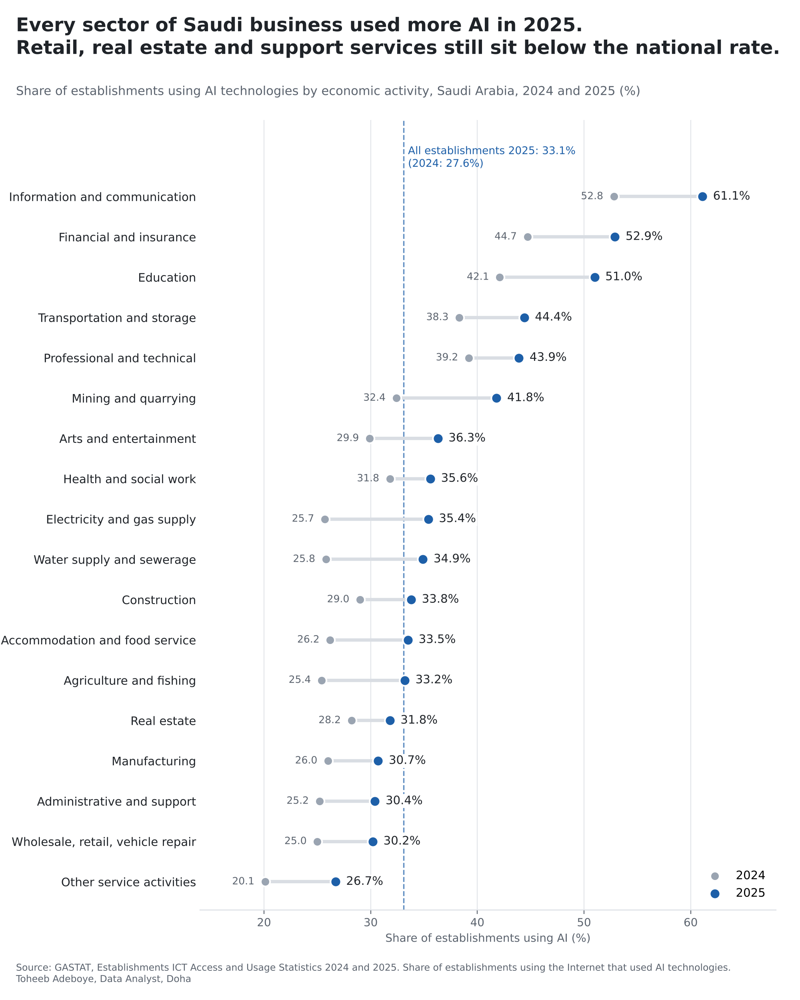
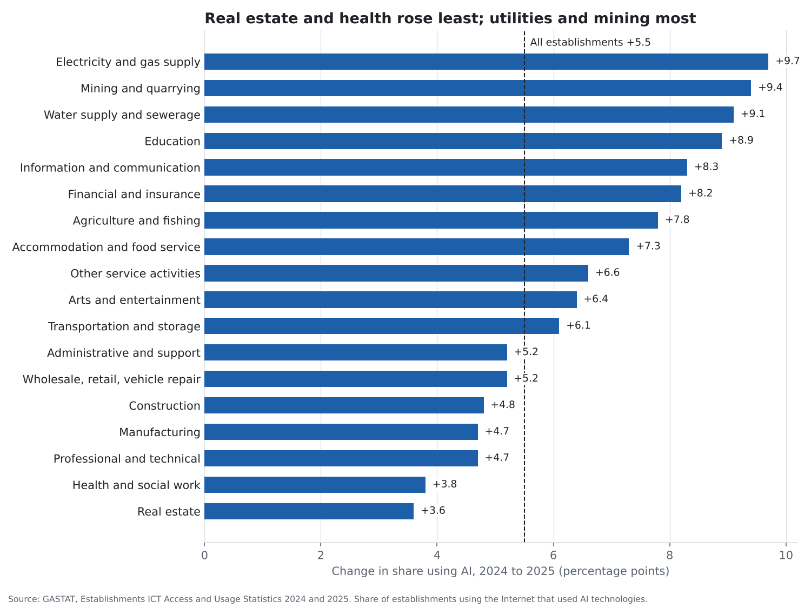

# AI Use by Saudi Businesses, by Sector

**Which sectors of Saudi business used AI in 2025, how fast did use grow from 2024, and which sectors still trail?**

[Notebook](notebooks/saudi_business_ai_adoption_analysis.ipynb) · [SQL](sql/analysis_queries.sql) · [Data dictionary](docs/data_dictionary.md) · [Tidy data](data/processed/ai_use_tidy.csv)



## Contents

1. [Project background](#project-background)
2. [Questions](#questions)
3. [Executive summary](#executive-summary)
4. [Insights](#insights)
5. [Recommendations](#recommendations)
6. [Data](#data)
7. [Method](#method)
8. [Tools](#tools)
9. [Repository structure](#repository-structure)
10. [How to reproduce](#how-to-reproduce)
11. [Assumptions and limitations](#assumptions-and-limitations)
12. [Sources](#sources)
13. [Author](#author)

## Project background

The General Authority for Statistics (GASTAT) of Saudi Arabia surveys establishments every year on how they use information and communication technology. Since the 2024 edition the survey asks whether an establishment uses artificial intelligence technologies, and GASTAT publishes the answer for all establishments and for 18 economic activities (ISIC Rev.4 sections). The 2024 survey drew a sample of 47,893 establishments of every size, from micro firms with one to five employees to large firms, across the 13 regions.

Survey figures on AI use by country are common. Figures by sector, from an official survey, for a Gulf economy, two years running, are rare. For a business owner they answer a practical question: how far ahead or behind is my sector, and is the gap closing? GASTAT prints the sector figures as chart labels, so this project reads both reports (the 2025 report in English and the 2024 report in Arabic), checks them against eight news reports of the same releases, and builds one table.

## Questions

1. What share of Saudi establishments used AI in 2025, and how much did that change from 2024?
2. Which sectors use AI most and least?
3. Did every sector move up, and which moved fastest and slowest?
4. Which sectors sit below the national rate?

## Executive summary

| Measure | Value |
|---|---|
| Establishments using AI, 2025 | 33.1% |
| Establishments using AI, 2024 | 27.6% |
| Change | +5.5 percentage points (+19.9%; GASTAT prints growth of 20.0%) |
| Sectors that rose | 18 of 18 |
| Highest sector, 2025 | Information and communication, 61.1% |
| Next highest | Financial and insurance 52.9%, education 51.0% |
| Lowest sector, 2025 | Other service activities, 26.7% |
| Sectors below the national rate, 2025 | 5: other services 26.7%, wholesale and retail trade (incl. vehicle repair) 30.2%, administrative and support 30.4%, manufacturing 30.7%, real estate 31.8% |
| Smallest rises | Real estate +3.6 pts, health and social work +3.8 pts |
| Largest rises | Electricity and gas +9.7 pts, mining +9.4 pts, water and sewerage +9.1 pts |
| Gap between highest and lowest sector | 34.4 pts in 2025, 32.7 pts in 2024 |

One in three Saudi establishments used AI in 2025, up from just over one in four in 2024. Every one of the 18 sectors moved up. The leaders are the sectors that handle information for a living: telecoms and IT, finance, and education. The sectors where most small, customer-facing businesses sit (shops, vehicle repair, real estate offices, administrative and support services) are still below the national rate, and real estate and health rose the least.



## Insights

**1. One in three Saudi establishments used AI in 2025, up 5.5 points in a year.**
The share rose from 27.6% in 2024 to 33.1% in 2025. GASTAT describes this as growth of 20.0%; the two rounded rates give a range of 19.5% to 20.3%, which contains the published figure.

| Year | Establishments using AI |
|---|---|
| 2024 | 27.6% |
| 2025 | 33.1% |

**2. Information-heavy sectors lead: information and communication 61.1%, finance 52.9%, education 51.0%.**
These three were also the top three in 2024 (52.8%, 44.7%, 42.1%) and each added more than 8 points. Transportation and storage (44.4%) and professional, scientific and technical activities (43.9%) follow.

**3. Every sector rose. The median sector added 6.5 points.**
The largest rises were in electricity and gas supply (+9.7 points, from 25.7% to 35.4%), mining (+9.4) and water supply and sewerage (+9.1). The gap between the highest and lowest sector widened slightly, from 32.7 to 34.4 points.

**4. Five sectors sit below the national rate, and they include many of the smallest customer-facing businesses.**

| Sector | 2025 | Gap to national (33.1%) |
|---|---|---|
| Real estate | 31.8% | -1.3 pts |
| Manufacturing | 30.7% | -2.4 pts |
| Administrative and support service | 30.4% | -2.7 pts |
| Wholesale and retail trade; repair of motor vehicles | 30.2% | -2.9 pts |
| Other service activities | 26.7% | -6.4 pts |

Thirteen of 18 sectors are above the national rate of 33.1%. Because the national rate is an average weighted by the number of establishments, this means the five sectors below it hold a large share of Saudi establishments.

**5. Real estate and health rose least.**
Real estate rose 3.6 points (28.2% to 31.8%) and human health and social work 3.8 points (31.8% to 35.6%), the two smallest rises of the 18. Real estate fell from 10th to 14th place among the 18 sectors, health from 7th to 8th.

## Recommendations

For owners and managers of businesses in Saudi Arabia and the wider Gulf:

1. **Benchmark against your own sector, not the national figure.** A real estate office at the sector rate (31.8%) and a software firm at its sector rate (61.1%) are both "average", but face very different competition.
2. **In sectors below the national rate, the first move is still open.** In retail, real estate, administrative services and other services, about seven in ten establishments did not use AI in 2025. A business that starts with one high-volume task (answering routine enquiries, booking, follow-up messages) is ahead of most of its sector.
3. **In health and real estate, watch the pace.** Both sectors were in the middle of the table in 2024 but added the fewest points in 2025, so other sectors are passing them. Clinics, agencies and property offices that want to keep up should not read the sector's slow year as a reason to wait.
4. **Measure use the way GASTAT does.** The survey asks whether AI is used at all. A firm planning its own adoption should also track which tasks AI handles and how much time or cost it saves, which the survey does not cover.

## Data

| File | Rows | Content |
|---|---|---|
| `data/raw/ai_use_readings.csv` | 138 | Every reading of every figure from 10 documents, with notes on set-aside readings |
| `data/raw/sources.csv` | 11 | Document list with links |
| `data/processed/ai_use_tidy.csv` | 38 | Year x sector, share using AI, verification status |
| `data/processed/ai_use_by_sector.csv` | 19 | Sector table with 2024, 2025, change and ranks |
| `data/processed/headline_figures.csv` | 13 | Headline figures used in this README |

Coverage: Saudi Arabia, all establishments and 18 ISIC Rev.4 sections, survey years 2024 and 2025.

Checks done:

- Each GASTAT report was read twice with different requests; both readings agree on all 36 sector figures.
- Every figure printed by more than one document agrees across documents (build script fails otherwise).
- The published growth of 20.0% lies inside the range implied by the two rounded national rates.
- No missing values, no duplicates, all values between 20.1% and 61.1%.
- Three 2024 values printed by Arab News and Fast Company Middle East were set aside (see limitations).

## Method

Descriptive comparison of two survey years. For each sector:

```
change_pts      = pct_2025 - pct_2024
change_rel_pct  = (pct_2025 / pct_2024 - 1) x 100
gap_to_national = pct_2025(sector) - pct_2025(all establishments)
```

Rounding check on the published growth rate (values printed to one decimal stand for anything within 0.05):

```
low  = (33.1 - 0.05) / (27.6 + 0.05) - 1 = 19.53%
high = (33.1 + 0.05) / (27.6 - 0.05) - 1 = 20.33%
published 20.0% lies inside [low, high]
```

## Tools

Python (pandas, matplotlib), SQL (SQLite), Jupyter notebook.

## Repository structure

```
saudi-business-ai-adoption/
  README.md
  requirements.txt
  data/raw/                ai_use_readings.csv, sources.csv
  data/processed/          ai_use_tidy.csv, ai_use_by_sector.csv, headline_figures.csv
  notebooks/               saudi_business_ai_adoption_analysis.ipynb
  scripts/                 build_data.py, make_charts.py
  sql/                     analysis_queries.sql
  images/                  saudi-business-ai-use-by-sector.png, change-by-sector.png
  docs/data_dictionary.md
```

## How to reproduce

```
pip install -r requirements.txt
python scripts/build_data.py
python scripts/make_charts.py
```

To run the SQL, load `data/processed/ai_use_tidy.csv` into SQLite as table `ai_use`.

## Assumptions and limitations

- **What is measured.** The indicator is the share of establishments using AI technologies among establishments that use the Internet (98.1% of establishments had Internet access in 2025). It says whether AI is used at all, not how much, for which tasks or with what result. GASTAT does not publish a definition of AI technologies in the report.
- **Not comparable with other countries' surveys.** Eurostat and TurkStat count enterprises with 10 or more employees and use all enterprises as the base; GASTAT includes micro establishments and uses Internet-using establishments as the base. The Saudi rate should not be set beside those figures.
- **Single-document figures.** 13 of the 19 figures for 2025 and 7 of 19 for 2024 appear only as chart labels in one GASTAT report (read twice, both readings agree). The national rates and the top sectors are confirmed in news reports.
- **Set-aside readings.** For 2024, Arab News and Fast Company Middle East print construction 25.8%, health 29.9% and arts 20.1%. In GASTAT's own chart, read in printed order, those values belong to water supply and sewerage, arts, and other services, and construction is 29.0%, health 31.8%. The outlets list 14 sectors and appear to have shifted one label. GASTAT's order is used; this affects the 2024 values of construction, health, arts and other services.
- **Several news outlets printing the same GASTAT release confirm that a number was transcribed correctly.** They are not independent measurements.
- **Two years only.** A change over one year can include sampling variation. GASTAT does not publish standard errors by sector in the report.
- The data shows how many establishments use AI, not why. The analysis does not attribute changes to any cause.

## Sources

General Authority for Statistics (GASTAT), Saudi Arabia:

- [Establishments ICT Access and Usage Statistics 2025 (English)](https://www.stats.gov.sa/documents/d/guest/establishments-ict-access-and-usage-statistics-2025-en-pdf)
- [Establishments ICT Access and Usage Statistics 2024 (Arabic)](https://www.stats.gov.sa/documents/20117/2435267/Establishments%2BICT%2BAccess%2Band%2BUsage%2BStatistics%2B2024-AR.pdf/dc535172-2b10-e1f2-da01-6a8cec13d645?t=1766638744600)
- [Methodology and Quality Report, Survey of Access and Use of ICT by Establishments 2024](https://stats.gov.sa/en/w/methodology-and-quality-report-for-the-statistics-of-the-survey-of-access-and-use-of-ict-by-establishments-2024)

GASTAT figures as reported by:

- Arab News: [2025 release](https://www.arabnews.com/node/2647105/business-economy), [2024 release](https://www.arabnews.pk/node/2627661/business-economy)
- Okaz (Arabic): [2025 release](https://www.okaz.com.sa/economy/na/2252516), [2024 release](https://www.okaz.com.sa/economy/na/2228246)
- Middle East AI News: [Saudi business AI adoption hits 33% in 2025](https://www.middleeastainews.com/p/saudi-business-ai-adoption-hits-33)
- Lets Data Science: [GASTAT reports 33.1% establishments used AI](https://letsdatascience.com/news/gastat-reports-331-establishments-used-ai-e5226d0c)
- MENA Startup Digest: [Saudi Arabia's AI adoption jumps to 33%](https://menastartupdigest.com/?p=42218)
- Fast Company Middle East: [2024 release](https://fastcompanyme.com/?p=47986)

## Author

Toheeb Adeboye, Data Analyst, Doha, Qatar. Founder of Baynor AI (https://baynor.qa). [LinkedIn](https://www.linkedin.com/in/dtsquarea/)
