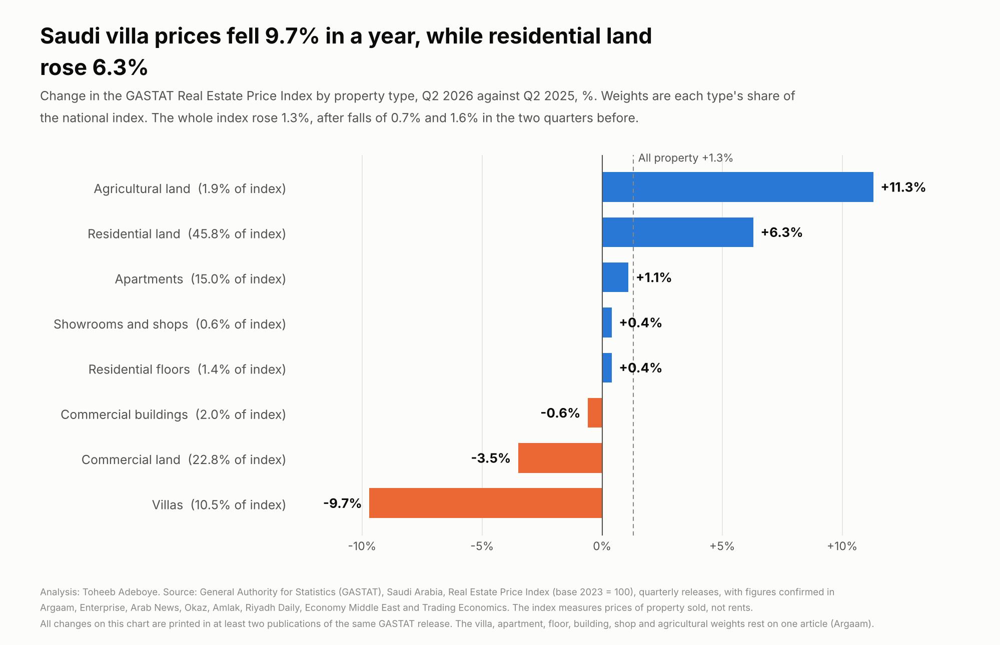
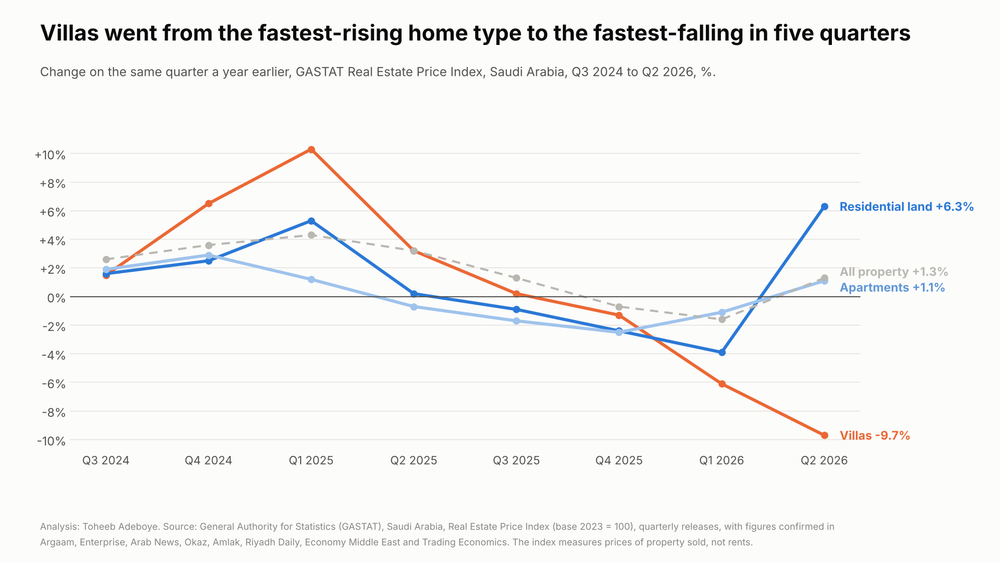
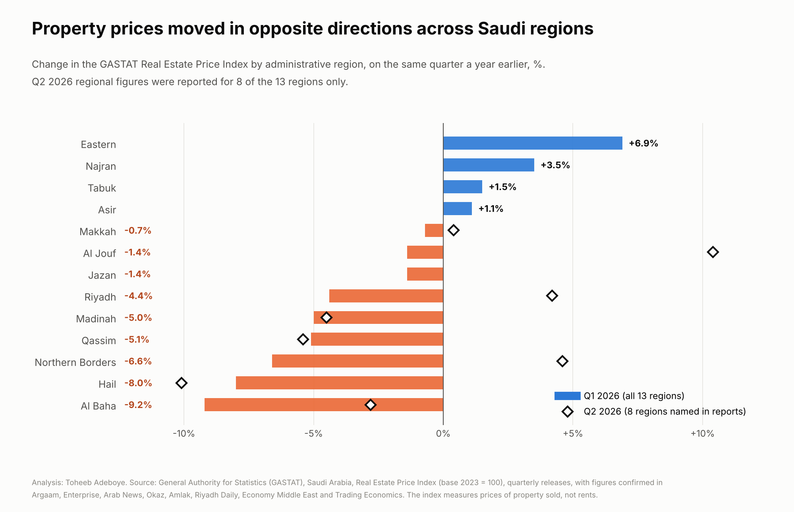

# Saudi Real Estate Prices by Property Type and Region

**Which kinds of property and which regions of Saudi Arabia got more or less expensive in the year to Q2 2026?**

[Notebook](notebooks/saudi_real_estate_prices_analysis.ipynb) · [SQL](sql/analysis_queries.sql) · [Data dictionary](docs/data_dictionary.md) · [Tidy data](data/processed/price_index_tidy.csv)



## Contents

1. [Project background](#project-background)
2. [Questions](#questions)
3. [Executive summary](#executive-summary)
4. [Insights](#insights)
5. [Recommendations](#recommendations)
6. [Data](#data)
7. [Method](#method)
8. [Tools](#tools)
9. [Repository structure](#repository-structure)
10. [How to reproduce](#how-to-reproduce)
11. [Assumptions and limitations](#assumptions-and-limitations)
12. [Sources](#sources)
13. [Author](#author)

## Project background

The General Authority for Statistics (GASTAT) of Saudi Arabia publishes a Real Estate Price Index every quarter. It tracks the prices of property that changes hands, using transaction records, for three sectors (residential, commercial, agricultural), ten property types and the 13 administrative regions. Since Q3 2024 the index uses a new method with 2023 as the base year (2023 = 100).

A single headline number hides a lot in this index. Land is close to half of it, and villas, apartments and land have not moved together in the last two years. For a family choosing between a villa and an apartment, a developer pricing a project, or a bank valuing collateral, the breakdown by type and region is what matters. GASTAT's own reports give only part of the regional table in text, so this project collects every quarterly figure from Q3 2024 to Q2 2026 from 26 documents (5 GASTAT documents and 21 reports of the same releases), checks them against each other and against the arithmetic that links them, and builds one series.

## Questions

1. Did property prices in Saudi Arabia rise or fall in the year to Q2 2026, and how does that compare with the quarters before?
2. Which property types rose and which fell?
3. How has the price path of villas, residential land and apartments differed since Q3 2024?
4. Which regions rose and which fell?

## Executive summary

| Measure | Value |
|---|---|
| National index, annual change, Q2 2026 | +1.3% (after -0.7% in Q4 2025 and -1.6% in Q1 2026) |
| National index, change on Q1 2026 | +3.0% |
| National index level, Q2 2026 (2023 = 100) | 106.4 (derived) |
| Villas, annual change, Q2 2026 | -9.7%, the largest fall of any property type |
| Villas, annual change, Q1 2025 | +10.3%, the largest rise of any residential type then |
| Residential land, annual change, Q2 2026 | +6.3% |
| Apartments, annual change, Q2 2026 | +1.1% |
| Commercial sector, annual change, Q2 2026 | -3.2% |
| Gap between fastest- and slowest-moving type, Q2 2026 | 21.0 points, the widest of the eight quarters |
| Regions rising on the year, Q1 2026 (latest with all 13) | 4 of 13, from Eastern +6.9% to Al Baha -9.2% |
| Regions in Q2 2026 (8 reported) | from Al Jouf +10.4% to Hail -10.1%; Riyadh +4.2% |



Saudi property prices returned to growth in Q2 2026, up 1.3% on the year and 3.0% on the quarter. The rise came from residential land, which is close to half of the index. Villas went the other way: down 9.7% on the year, five quarters after they were the fastest-rising home type. Across regions the picture was split, with four of 13 regions up on the year in Q1 2026.

## Insights

**1. The national index rose 1.3% on the year in Q2 2026, after two quarters of annual decline.**

| Quarter | Index (2023 = 100) | Annual change | Change on previous quarter |
|---|---|---|---|
| Q3 2024 | 102.50 | +2.6% | |
| Q4 2024 | 104.18 | +3.6% | +1.6% |
| Q1 2025 | 104.93 | +4.3% | +0.7% |
| Q2 2025 | 105.00 | +3.2% | +0.1% |
| Q3 2025 | 103.90 (derived) | +1.3% | -1.1% |
| Q4 2025 | 103.48 | -0.7% | -0.4% |
| Q1 2026 | 103.30 | -1.6% | -0.2% |
| Q2 2026 | 106.40 (derived) | +1.3% | +3.0% |

The 3.0% quarterly rise in Q2 2026 is the largest in the eight quarters covered. The annual rate was highest in Q1 2025 (+4.3%) and lowest in Q1 2026 (-1.6%).

**2. In Q2 2026 villas fell 9.7% on the year, the largest fall of any property type. Residential land rose 6.3%.**

| Property type | Weight in index | Annual change, Q2 2026 | Change on Q1 2026 |
|---|---|---|---|
| Agricultural land | 1.9% | +11.3% | |
| Residential land | 45.8% | +6.3% | +6.1% |
| Apartments | 15.0% | +1.1% | +0.9% |
| Showrooms and shops | 0.6% | +0.4% | +3.8% |
| Residential floors | 1.4% | +0.4% | -1.1% |
| Commercial buildings | 2.0% | -0.6% | -0.3% |
| Commercial land | 22.8% | -3.5% | |
| Villas | 10.5% | -9.7% | -2.1% |

The residential sector as a whole rose 2.6% and the commercial sector fell 3.2%. The gap between the fastest-rising and fastest-falling type was 21.0 percentage points, the widest of the eight quarters (6.0 points in Q4 2025, 17.9 in Q1 2026).

**3. Villas went from the fastest-rising home type to the fastest-falling in five quarters.**

| Quarter | Villas | Residential land | Apartments | All property |
|---|---|---|---|---|
| Q3 2024 | +1.5% | +1.6% | +1.9% | +2.6% |
| Q4 2024 | +6.5% | +2.5% | +2.9% | +3.6% |
| Q1 2025 | +10.3% | +5.3% | +1.2% | +4.3% |
| Q2 2025 | +3.2% | +0.2% | -0.7% | +3.2% |
| Q3 2025 | +0.2% | -0.9% | -1.7% | +1.3% |
| Q4 2025 | -1.3% | -2.4% | -2.5% | -0.7% |
| Q1 2026 | -6.1% | -3.9% | -1.1% | -1.6% |
| Q2 2026 | -9.7% | +6.3% | +1.1% | +1.3% |

Annual change on the same quarter a year earlier. Villas have fallen on the year for three quarters in a row, by more each quarter. Residential land turned from -3.9% to +6.3% in one quarter, and apartments from -1.1% to +1.1%.

**4. Regions moved in opposite directions. In Q1 2026, the latest quarter with all 13 regions, four rose on the year and nine fell.**



| Region | Index, Q1 2026 | Annual change, Q1 2026 | Annual change, Q2 2026 | Change Q3 2024 to Q1 2026 |
|---|---|---|---|---|
| Eastern | 97.8 | +6.9% | not reported | +6.3% |
| Najran | 105.6 | +3.5% | not reported | +8.0% |
| Tabuk | 102.0 | +1.5% | not reported | +1.8% |
| Asir | 88.5 | +1.1% | not reported | -4.2% |
| Makkah | 99.4 | -0.7% | +0.4% | +0.8% |
| Al Jouf | 95.6 | -1.4% | +10.4% | -2.5% |
| Jazan | 100.3 | -1.4% | not reported | 0.0% |
| Riyadh | 109.8 | -4.4% | +4.2% | 0.0% |
| Madinah | 93.6 | -5.0% | -4.5% | -6.0% |
| Qassim | 91.9 | -5.1% | -5.4% | -5.8% |
| Northern Borders | 100.0 | -6.6% | +4.6% | -1.8% |
| Hail | 95.4 | -8.0% | -10.1% | -5.6% |
| Al Baha | 76.1 | -9.2% | -2.8% | -4.6% |

Riyadh has the highest index level of the 13 regions in every quarter covered, and its level in Q1 2026 (109.8) was the same as in Q3 2024. Over those six quarters Najran rose most (+8.0%) and Madinah fell most (-6.0%). In Q2 2026, Riyadh, Al Jouf, Northern Borders and Makkah turned from annual falls to annual rises; Hail, Qassim, Madinah and Al Baha kept falling.

## Recommendations

For **home buyers** in Saudi Arabia:

- Villa prices are 9.7% lower than a year earlier and have fallen for three quarters in a row, while apartments are up 1.1%. A buyer who can choose between the two has more room to negotiate on a villa than a year ago.
- Land is moving the other way: residential land rose 6.1% in a single quarter. Anyone planning to buy a plot and build should expect land prices above last year's.

For **developers and property investors**:

- Price villas against the current quarter, not against 2025: the villa index fell from +10.3% on the year in Q1 2025 to -9.7% in Q2 2026.
- Look at the region before the national figure. In Q1 2026 annual changes ran from +6.9% (Eastern) to -9.2% (Al Baha), and in Q2 2026 from +10.4% (Al Jouf) to -10.1% (Hail).

For **banks and valuers**:

- Collateral values set a year ago can be far from today's: villas are 9.7% lower and residential land 6.3% higher than a year earlier. The quarterly GASTAT index by type and region is a reference for updating them between full valuations.

## Data

| File | Rows | Content |
|---|---|---|
| `data/raw/sources.csv` | 26 | Documents used, with links |
| `data/raw/price_index_readings.csv` | 725 | Every figure read, one row per figure per document, 8 set aside with a reason |
| `data/processed/price_index_tidy.csv` | 424 | Consolidated figures (414) and derived index levels (10), with how each is confirmed |
| `data/processed/national_index.csv` | 22 | National index, Q1 2021 to Q2 2026 |
| `data/processed/segment_changes.csv` | 92 | Annual and quarterly change by sector and property type, Q3 2024 to Q2 2026 |
| `data/processed/region_index.csv` | 99 | Index level and annual change, 13 regions, Q3 2024 to Q2 2026 |
| `data/processed/identity_checks.csv` | 92 | Arithmetic checks between published figures, all passed |
| `data/processed/headline_figures.csv` | 34 | Figures quoted in this README |

Coverage: national index Q1 2021 to Q2 2026; 3 sectors and 9 property types Q3 2024 to Q2 2026 (some types missing in Q4 2024 and Q4 2025); all 13 regions Q3 2024 to Q1 2026, 8 regions in Q2 2026.

Checks done:

- Row counts, duplicates and missing values (none in the tidy table).
- Every figure printed in more than one document is compared. The build script stops if two documents disagree. Eight readings were set aside, each with the reason in the raw file: two where a news report differs by 0.1 from GASTAT's own report (the GASTAT figure is used), and six where a sign, a quarter or a digit does not match the other documents and the arithmetic.
- 57 annual changes are checked against index levels four quarters apart, 13 quarterly changes against levels one quarter apart, and 22 annual changes against the product of four quarterly changes. All 92 pass, allowing for rounding.
- How each figure is confirmed: of 198 annual changes, 131 are printed by two or more publishers. Every figure in the headline chart is printed by at least two publishers, and all but agricultural land by five.

## Method

The index is GASTAT's own. This project does not re-weight or re-estimate it; it collects the published figures, checks them and compares them.

Percent change on a period, as GASTAT computes it:

```
annual change (%)    = (index in quarter t / index in quarter t-4 - 1) x 100
quarterly change (%) = (index in quarter t / index in quarter t-1 - 1) x 100
```

Checks between published figures, with each figure allowed to be anywhere within half a unit of its last printed digit:

```
(1 + annual change) = (1 + qoq t) x (1 + qoq t-1) x (1 + qoq t-2) x (1 + qoq t-3)
```

Index levels not printed in any document found are derived, and marked `derived`:

```
national level, Q2 2026 = level Q1 2026 x (1 + qoq Q2 2026) = 103.3 x 1.030 = 106.40
                 check:   level Q2 2025 x (1 + annual Q2 2026) = 105.0 x 1.013 = 106.37
national level, Q3 2025 = level Q4 2025 / (1 + qoq Q4 2025) = 103.48 / 0.996 = 103.90
regional level, Q2 2026 = level Q2 2025 x (1 + annual change Q2 2026)
```

The six-quarter regional change is (level Q1 2026 / level Q3 2024 - 1) x 100. Q3 2024 is the first quarter under the 2023-base method.

## Tools

Python (pandas, matplotlib), SQL (SQLite), Jupyter notebook.

## Repository structure

```
saudi-real-estate-prices/
  README.md
  requirements.txt
  data/raw/sources.csv
  data/raw/price_index_readings.csv
  data/processed/price_index_tidy.csv
  data/processed/national_index.csv
  data/processed/segment_changes.csv
  data/processed/region_index.csv
  data/processed/identity_checks.csv
  data/processed/headline_figures.csv
  notebooks/saudi_real_estate_prices_analysis.ipynb
  scripts/build_data.py
  scripts/make_charts.py
  sql/analysis_queries.sql
  images/saudi-property-prices-by-type.png
  images/residential-types-trend.png
  images/regions-annual-change.png
  docs/data_dictionary.md
```

## How to reproduce

```
pip install -r requirements.txt
python scripts/build_data.py      # rebuilds data/processed and runs every check
python scripts/make_charts.py     # redraws the charts in images/
```

Then open `notebooks/saudi_real_estate_prices_analysis.ipynb`, which recomputes the headline figures and asserts that they match the build script. The SQL queries run on the processed CSV files loaded as tables of the same name (tested with SQLite).

## Assumptions and limitations

- The index measures the prices of property that was sold, from transaction records. It does not measure rents, and it does not adjust for the size or quality of what was sold in each quarter beyond GASTAT's own method.
- GASTAT's regional table and most index levels were not readable in its own reports; they come from Argaam, which prints the full table each quarter. They are confirmed indirectly: every regional annual change that GASTAT or another publisher prints matches Argaam's, and the Argaam levels reproduce the printed annual changes in all 57 tests. Still, the regional levels rest on one publisher.
- Q1 2026 annual changes for Al Jouf (-1.4%), Jazan (-1.4%) and Madinah (-5.0%) are printed by Argaam only. GASTAT's Q1 2026 report shows -1.4, -1.4 and -5.0 in a chart without region labels, which is consistent.
- Q2 2026 regional figures were found for 8 of the 13 regions. Eastern, Najran, Tabuk, Asir and Jazan have none, so the latest complete regional comparison is Q1 2026. Q2 2026 regional levels are derived, and the quarter-on-quarter jumps they imply (for example Al Jouf from 95.6 to 107.0) rest on a single quarter's figure.
- Several outlets printing the same GASTAT release confirm that a number was transcribed correctly. They are not independent measurements.
- Weights: residential (72.7%), residential land (45.8%), commercial (25.4%) and commercial land (22.8%) are from 2025 and 2026 GASTAT reports. Villa (10.5%), apartment (15.0%), floor (1.4%), commercial building (2.0%), showroom (0.6%) and agricultural (1.9%) weights are from one Argaam article (Q3 2024).
- National levels before Q3 2024 (Q1 2021 to Q2 2024) come from one Argaam table and were back-calculated by GASTAT on the 2023 base. They are shown for context only.
- Small segments move a lot from quarter to quarter: agricultural land is under 2% of the index and showrooms under 1%.
- The data shows how prices changed, not why. The analysis does not attribute changes to any cause.

## Sources

General Authority for Statistics (GASTAT), Saudi Arabia:

- [Real Estate Price Index, Q1 2026](https://stats.gov.sa/documents/20117/2435267/RPI+Q1+2026+EN.pdf/87b832df-68f6-bd48-5094-8738b19e6d24)
- [Real Estate Prices in Saudi Arabia decline by 0.7% in Q4 2025](https://www.stats.gov.sa/en/w/news/157)
- [Real Estate Price Index, Q2 2025](https://www.stats.gov.sa/documents/20117/2435267/RPI+Q2+2025+EN+(1).pdf/7f84a535-b9f7-9eb2-917d-a4c483096144?t=1754202887510)
- [Real Estate Price Index, Q1 2025](https://www.stats.gov.sa/documents/d/guest/rpi-q1-2025-en-pdf)
- [Real Estate Price Index, Q4 2024](https://www.stats.gov.sa/documents/20117/2435267/RPI+Q4+2024+EN+(1).pdf/d01a3a6c-1946-105f-893f-be30f6903854?t=1737527285827)

GASTAT figures as reported by:

- Argaam: [Q1 2026](https://www.argaam.com/en/article/articledetail/id/1897833), [Q4 2025](https://www.argaam.com/en/article/articledetail/id/1873921), [Q3 2025](https://www.argaam.com/en/article/articledetail/id/1851033), [Q2 2025](https://www.argaam.com/en/article/articledetail/id/1832785), [Q1 2025](https://betapp.argaamcharts.com/en/article/articledetail/id/1805011), [Q4 2024](https://www.argaam.com/en/article/articledetail/id/1783362), [Q3 2024](https://www.argaam.com/en/article/articledetail/id/1763931)
- Enterprise: [Q2 2026](https://enterpriseam.com/ksa/2026/07/21/real-estate-prices-return-to-growth-in-2q-after-two-quarters-of-decline/), [Q1 2026](https://enterpriseam.com/ksa/2026/04/21/real-estate-prices-fall-further-easing-1-6-in-1q-2026/), [Q3 2025](https://enterpriseam.com/ksa/2025/10/21/real-estate-prices-see-slowest-rise-in-two-years-in-3q/), [Q2 2025](https://enterpriseam.com/ksa/2025/08/04/residential-real-estate-prices-finally-cool-down-in-2q/), [Q1 2025](https://enterpriseam.com/ksa/2025/04/16/real-estate-prices-up-4-3-y-o-y-in-1q-2025/)
- Arab News: [Saudi home prices lift real estate index 1.3% in Q2](https://www.arabnews.pk/node/2651585/business-economy)
- Okaz (Arabic): [Q2 2026](https://www.okaz.com.sa/economy/na/2257730), [Q3 2025](https://www.okaz.com.sa/economy/na/2218496)
- Amlak: [Q2 2026](https://amlak.net.sa/en/107731/), [Q3 2024](https://amlak.net.sa/en/70448/)
- Trading Economics: [Saudi Real Estate Rebounds in Q2](https://tradingeconomics.com/saudi-arabia/house-price-index-yoy/news/568112), [Saudi Arabia Real Estate Inflation Slows in Q3](https://tradingeconomics.com/saudi-arabia/house-price-index-yoy/news/494301)
- Riyadh Daily: [GASTAT Reports 0.7% Decrease in Real Estate Price Index for Q4 2025](https://www.alriyadhdaily.com/article/53dae013d12c4fd88bbcc5e15758b990)
- Economy Middle East: [Saudi real estate price index Q4 2024](https://economymiddleeast.com/news/saudi-real-estate-price-index-q4-2024-3-6-percent-annual-growth-driven-by-residential-commercial-sectors)

## Author

Toheeb Adeboye, Data Analyst, Doha, Qatar. [LinkedIn](https://www.linkedin.com/in/dtsquarea/)
